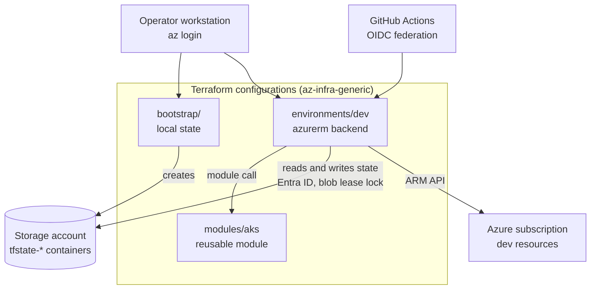
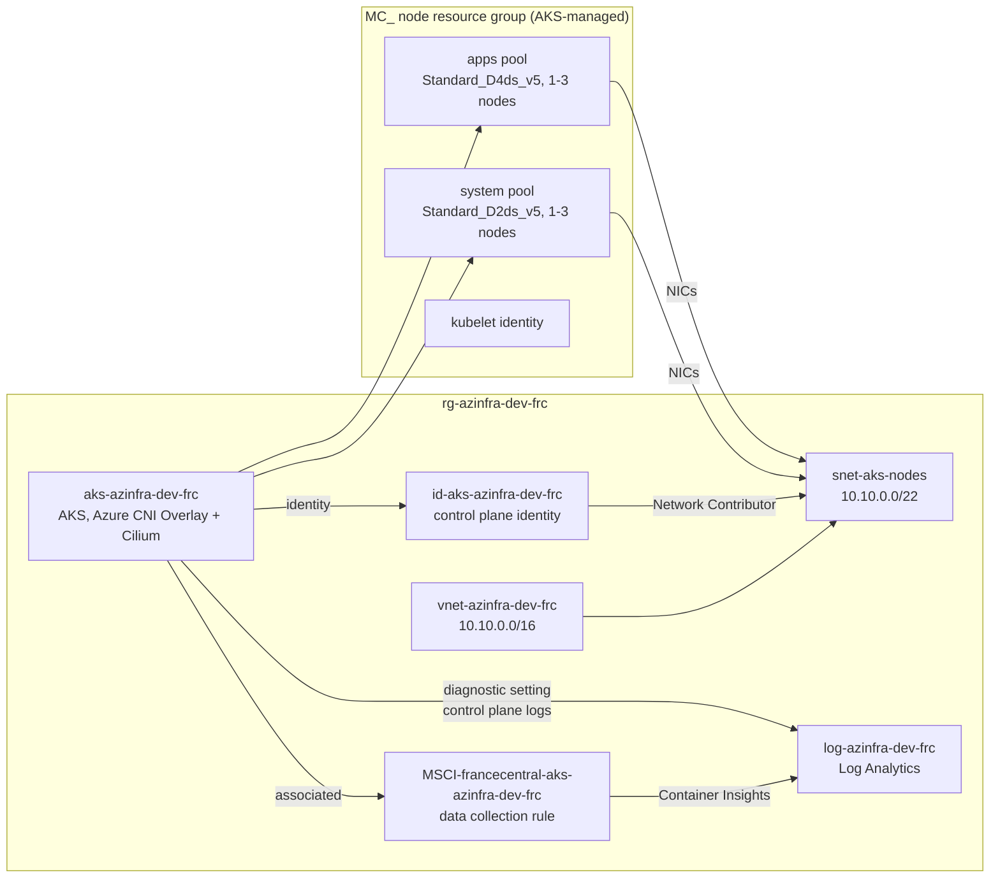
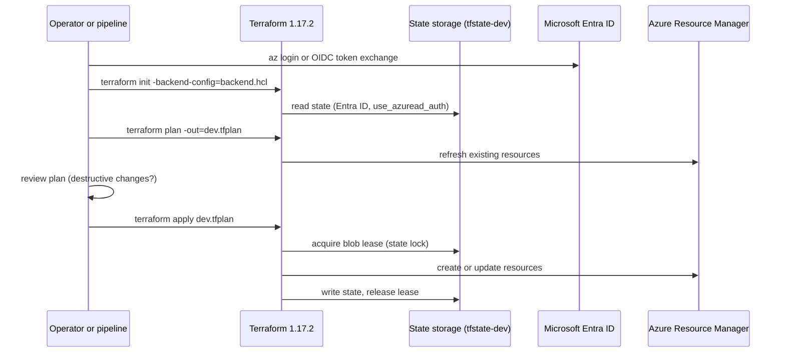

# 01 Architecture

| | |
|---|---|
| **Scope** | `az-infra-generic`: bootstrap, `environments/dev`, `modules/aks` |
| **Status** | Implemented and validated offline; not deployed (pending Azure access) |
| **Source of truth** | Terraform code under `az-infra-generic/` |

## 1. Purpose and scope

`az-infra-generic` provisions Azure infrastructure with Terraform around one
reusable building block: the **AKS module** (`modules/aks`). It contains:

* a **bootstrap** configuration that creates the Terraform remote state storage;
* one implemented environment, **dev**, that owns the resource group, network
  and Log Analytics workspace and instantiates the AKS module;
* the **AKS module**, consumable by other projects without modification.

Out of scope (not implemented): container registry, Key Vault, private DNS
zones, firewall/NAT resources, other environments than `dev`.

## 2. Components

| Component | Path | Role | Terraform state | Status |
|---|---|---|---|---|
| Bootstrap | `bootstrap/` | Storage account, per-environment state containers, Entra ID data-plane roles, delete lock | Local file `bootstrap/terraform.tfstate` | Implemented |
| dev environment | `environments/dev/` | Resource group, VNet + node subnet, Log Analytics workspace, AKS module call | Remote: `tfstate-dev` / `az-infra-generic/aks.tfstate` | Implemented |
| AKS module | `modules/aks/` | Cluster, control plane identity, node pools, role assignments, monitoring wiring | Part of the calling configuration's state | Implemented |
| rec / ppr / prod environments | `environments/rec`, `ppr`, `prod` (empty) | State containers exist after bootstrap; roots not written | — | Not implemented |
| CI/CD pipeline | `.github/workflows/az-infra-generic.yml` + reusable workflows | Quality and security gates, plan, approval, apply | — | Implemented; Azure stages pending |

## 3. Diagrams

### 3.1 Configuration layers

### 3.2 Resources of the dev environment

### 3.3 Deployment sequence

## 4. Directory and file organization

| Path | Content |
|---|---|
| `.terraform-version` | Exact CLI version (1.17.2) for tfenv/tenv and CI |
| `.tflint.hcl`, `.checkov.yaml`, `.checkov-prod.yaml`, `.trivyignore.yaml` | Lint and security scanner configuration ([pipeline documentation](../../../docs/ci-cd.md)) |
| `bootstrap/versions.tf` | Terraform/provider constraints **and** the provider block (no backend: local state) |
| `bootstrap/variables.tf`, `main.tf`, `outputs.tf` | State storage definition |
| `environments/dev/backend.tf` | Partial `azurerm` backend: container `tfstate-dev`, key, Entra ID auth |
| `environments/dev/backend.hcl.example` | Template of the generated `backend.hcl` (storage account name) |
| `environments/dev/versions.tf`, `providers.tf` | Constraints and provider configuration |
| `environments/dev/variables.tf`, `locals.tf`, `main.tf`, `outputs.tf`, `terraform.tfvars` | dev environment |
| `modules/aks/*.tf` | Module: `versions`, `variables`, `locals`, `identity`, `main`, `node_pools`, `monitoring`, `outputs` |
| `*/tests/*.tftest.hcl` | Offline `terraform test` suites (mocked provider) |
| `*/.terraform.lock.hcl` | Provider lock files of the root configurations (4 platforms) |

## 5. AKS module architecture

Resources created by the module, in dependency order:

| Order | Resource (address inside the module) | File | Condition |
|---|---|---|---|
| 1 | `azurerm_user_assigned_identity.cluster[0]` | `identity.tf` | `identity_type = "UserAssigned"` and no identity provided |
| 2 | `azurerm_role_assignment.network_contributor["<key>"]` | `identity.tf` | per entry of `network_contributor_subnet_ids` |
| 3 | `azurerm_kubernetes_cluster.this` | `main.tf` | always (waits for 2) |
| 4 | `azurerm_kubernetes_cluster_node_pool.this["<pool>"]` | `node_pools.tf` | per entry of `node_pools` |
| 4 | `azurerm_monitor_data_collection_rule.container_insights[0]` + `..._association.container_insights[0]` | `monitoring.tf` | `monitoring` set, Container Insights enabled |
| 4 | `azurerm_monitor_diagnostic_setting.cluster[0]` | `monitoring.tf` | `monitoring` set, diagnostics enabled |
| 4 | `azurerm_role_assignment.cluster_admin["<key>"]` | `identity.tf` | per entry of `cluster_admin_principal_ids` |
| 4 | `azurerm_role_assignment.acr_pull["<key>"]` | `identity.tf` | per entry of `container_registry_ids` |

Plan-time **checks** (warnings, never blocking): `check.workload_node_pool`
(no User pool while the system pool only accepts critical add-ons) and
`check.cluster_admin_access` (no administrator while local accounts are
disabled). Full interface: 04 AKS module operations and the [project README §9](../../README.md#9-aks-module-inputs-and-outputs).

## 6. Provider architecture

| Aspect | Implementation |
|---|---|
| Provider | `hashicorp/azurerm` 5.14.0 (lock file), constraint `~> 5.14` in roots, `>= 5.14.0, < 6.0.0` in the module |
| Provider block location | `environments/dev/providers.tf`, `bootstrap/versions.tf`; **none in the module** (callers configure it) |
| Authentication | Never in code. Resolved from `ARM_*` environment variables (OIDC in CI) or the Azure CLI session |
| Resource provider registration | azurerm 5.x registers none by default; variable `resource_providers_to_register` lists them (bootstrap: `Microsoft.Storage`; dev: Compute, ContainerService, Insights, ManagedIdentity, Network, OperationalInsights, OperationsManagement, PolicyInsights). Set `[]` if registration is managed elsewhere |
| `features` block | `resource_group.prevent_deletion_if_contains_resources = true` |
| Bootstrap only | `storage_use_azuread = true` (Shared Key is disabled on the state account) |

## 7. Environment integration

| Environment | Terraform root | State container | Pipeline jobs | Status |
|---|---|---|---|---|
| dev | `environments/dev` | `tfstate-dev` | `plan-dev`, `apply-dev` | Implemented, not deployed |
| rec | — (empty directory) | `tfstate-rec` (created by bootstrap) | — | Not implemented |
| ppr | — (empty directory) | `tfstate-ppr` | — | Not implemented |
| prod | — (empty directory) | `tfstate-prod` | `plan-prod`, `apply-prod` (fail until the root exists) | Not implemented |

Creating a new environment from dev: [project README §2](../../README.md#adding-an-environment-rec-ppr-prod).

## 8. Remote state architecture

One storage account holds one private container per environment
(`tfstate-<env>`) plus `tfstate-bootstrap`. Access is Entra ID only (Shared
Key disabled), locking uses native blob leases, versioning and 30-day soft
delete protect every state revision. Details and procedures:
03 Backend and state management, and the [project README §6](../../README.md#6-remote-backend-architecture).

## 9. Naming conventions

`<CAF abbreviation>-<project>-<environment>-<region code>`, defined in
`environments/dev/locals.tf` (region codes: `francecentral → frc`,
`westeurope → weu`, … unknown regions keep their full name).

| Resource | Pattern | dev value |
|---|---|---|
| Resource group | `rg-<project>-<env>-<region>` | `rg-azinfra-dev-frc` |
| Virtual network | `vnet-<project>-<env>-<region>` | `vnet-azinfra-dev-frc` |
| Node subnet | fixed | `snet-aks-nodes` |
| Log Analytics | `log-<project>-<env>-<region>` | `log-azinfra-dev-frc` |
| AKS cluster | `aks-<project>-<env>-<region>` | `aks-azinfra-dev-frc` |
| Control plane identity | `id-<cluster name>` | `id-aks-azinfra-dev-frc` |
| Data collection rule | `MSCI-<region>-<cluster name>` | `MSCI-francecentral-aks-azinfra-dev-frc` |
| Diagnostic setting | `diag-<cluster name>` | `diag-aks-azinfra-dev-frc` |
| Node pools | map keys | `system`, `apps` |

Tags on every resource: `project`, `environment`, `managed_by = terraform`,
`stack = aks` (+ `module = aks` on module resources).

## 10. Infrastructure lifecycle

| Phase | Frequency | Configuration | Runbook |
|---|---|---|---|
| Backend bootstrap | Once per subscription | `bootstrap/` | 03 Backend and state management |
| Environment creation | Once per environment | `environments/<env>/` | 05 Deployment procedures |
| Configuration change | Per change (PR → plan → approval → apply) | `environments/<env>/terraform.tfvars`, module | 05 and 06 |
| Kubernetes patch upgrades | Automatic (`patch` channel, maintenance windows) | module defaults | 04 AKS module operations |
| Kubernetes minor upgrades | Planned change | `kubernetes_version` | 04 AKS module operations |
| Provider / Terraform upgrades | Periodic | `versions.tf`, lock files | 08 Security and maintenance |
| Destruction | Exceptional | `terraform destroy` with review | 05 Deployment procedures |

## 11. External dependencies

| Dependency | Used for | Required permissions / notes |
|---|---|---|
| Azure subscription | All resources | See 02 Prerequisites and initial setup |
| Microsoft Entra ID | Authentication, AKS RBAC, admin groups | Groups for cluster administrators (object IDs) |
| Azure resource providers | Listed in §6 | `*/register/action` or pre-registration |
| vCPU quota (DDSv5 family) | Node pools | ≥ 6 vCPUs for dev, up to about 24 during scale-out with surge |
| `registry.terraform.io` | Provider download at `terraform init` | Outbound HTTPS |
| GitHub (Actions, OIDC issuer) | Pipeline | Repository settings, environments, variables |
| Container images (`mcr.microsoft.com`) | AKS add-ons | Egress from the node subnet (load balancer outbound) |

## 12. References

* [Project README](../../README.md) (reference tables, examples, limitations §14)
* [Pipeline documentation](../../../docs/ci-cd.md)
* Module README: `modules/aks/README.md`
