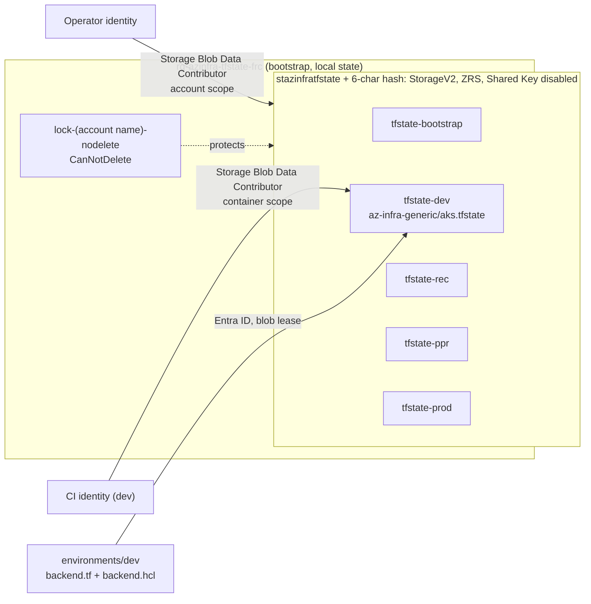

# 03 Backend and state management

| | |
|---|---|
| **Scope** | `az-infra-generic/bootstrap` and the `azurerm` backend of `environments/<env>` |
| **Status** | Implemented; bootstrap plan validated offline (`bootstrap/tests`, 7 runs). All Azure-side procedures: **Pending external prerequisites** |
| **Code** | `bootstrap/main.tf`, `bootstrap/variables.tf`, `bootstrap/outputs.tf`, `environments/dev/backend.tf`, `environments/dev/backend.hcl.example` |
| **Controls reference** | [project README §6](../../README.md#6-remote-backend-architecture) |

> [!WARNING]
> Terraform state contains sensitive values in clear text (for example the AKS
> kubeconfig, storage account keys of the bootstrap). Treat state files and
> state access like cluster-admin credentials: never commit them, never paste
> them in tickets or chats, delete local copies after use.

## 1. Architecture



| Property | Implementation |
|---|---|
| Isolation | One container per environment; `container_name` and `key` hardcoded in `environments/<env>/backend.tf`; `backend.hcl` holds only `storage_account_name` |
| Authentication | Entra ID only (`shared_access_key_enabled = false`, backend `use_azuread_auth = true`) |
| Locking | Native blob lease taken by the backend for every state-writing operation |
| Recovery | Blob versioning + 30-day soft delete (blobs and containers) |
| Encryption | Storage Service Encryption + infrastructure (double) encryption, HTTPS/TLS 1.2 |
| Deletion protection | `prevent_destroy` (Terraform) + `CanNotDelete` lock (Azure) |

## 2. Bootstrap configuration reference

| Input | Default | Purpose |
|---|---|---|
| `project` | `"azinfra"` | Name component (2-9 lowercase alphanumerics) |
| `location` | `"francecentral"` | Region of the state storage |
| `resource_group_name` | `null` → `rg-<project>-tfstate-<region>` | Override the resource group name |
| `storage_account_name` | `null` → `st<project>tfstate<hash6>` | Override the globally unique account name |
| `environments` | `["dev", "rec", "ppr", "prod"]` | One `tfstate-<env>` container each (+ `tfstate-bootstrap`) |
| `state_contributors` | `{}` | `{ <env> = ["<principal-object-id>"] }`: container-scoped data access |
| `grant_current_principal_access` | `true` | Account-scoped data access for the identity running the bootstrap |
| `account_replication_type` | `"ZRS"` | LRS, ZRS, GRS, RAGRS, GZRS, RAGZRS |
| `blob_soft_delete_retention_days` / `container_soft_delete_retention_days` | `30` / `30` | Recovery windows (1-365) |
| `public_network_access` | `"Enabled"` | `Enabled`, `Disabled`, `SecuredByPerimeter` |
| `allowed_ip_ranges` | `[]` | IP allow-list (switches the network default action to Deny) |
| `delete_lock_enabled` | `true` | `CanNotDelete` management lock |
| `resource_providers_to_register` | `["Microsoft.Storage"]` | Set `[]` if registration is managed elsewhere |

| Output | Use |
|---|---|
| `storage_account_name` | Backend configuration of every environment |
| `backend_hcl` | Ready-to-write content of `environments/<env>/backend.hcl` |
| `state_containers` | Container names and resource IDs (scopes for role assignments) |
| `resource_group_name`, `storage_account_id`, `blob_endpoint` | Inspection, additional role assignments |

## BS-01 Bootstrap the backend

**Status:** Pending external prerequisites.
**Purpose:** create the state storage once per subscription.
**Prerequisites:** [02 SETUP-01..04](02-prerequisites-and-setup.md), *Owner*
(or *Contributor* + *User Access Administrator*) on the subscription.
**Context:** `az-infra-generic/bootstrap`, bash.

1. Authenticate and select the subscription:

   ```bash
   az login --tenant "<TENANT_ID>"
   az account set --subscription "<SUBSCRIPTION_ID>"
   export ARM_SUBSCRIPTION_ID="$(az account show --query id -o tsv)"
   ```

2. Initialize, validate and test (no Azure call):

   ```bash
   cd az-infra-generic/bootstrap
   terraform init
   terraform validate && terraform test
   ```

3. Plan and review. With default inputs the plan adds **9** resources: the
   resource group, the storage account, 5 containers (`tfstate-bootstrap`,
   `-dev`, `-rec`, `-ppr`, `-prod`), the current-principal role assignment and
   the management lock (+1 role assignment per `state_contributors` entry).

   ```bash
   terraform plan -out=bootstrap.tfplan
   # optional inputs, e.g.:
   #   -var 'state_contributors={dev=["<ci-dev-principal-object-id>"]}'
   #   -var 'allowed_ip_ranges=["<operator-public-ip>"]'
   ```

4. Apply the reviewed plan and display the outputs:

   ```bash
   terraform apply bootstrap.tfplan
   terraform output
   ```

**Expected result:** `Apply complete! Resources: 9 added`, outputs show the
storage account name.

**Validation:**

```bash
SA="$(terraform output -raw storage_account_name)"
az storage account show -n "$SA" -g rg-azinfra-tfstate-frc \
  --query "{sharedKey:allowSharedKeyAccess, tls:minimumTlsVersion, httpsOnly:enableHttpsTrafficOnly, infraEncryption:encryption.requireInfrastructureEncryption}" -o table
az storage account blob-service-properties show --account-name "$SA" -g rg-azinfra-tfstate-frc \
  --query "{versioning:isVersioningEnabled, blobSoftDeleteDays:deleteRetentionPolicy.days, containerSoftDeleteDays:containerDeleteRetentionPolicy.days}" -o table
az storage container list --account-name "$SA" --auth-mode login --query "[].name" -o tsv
az lock list -g rg-azinfra-tfstate-frc -o table
```

Expected: `sharedKey False`, `TLS1_2`, `httpsOnly True`,
`infraEncryption True`, versioning `True`, 30/30 days, the five containers, one
`CanNotDelete` lock.

**Troubleshooting:** `StorageAccountAlreadyTaken` → set
`-var 'storage_account_name=<unique-name>'`. `AuthorizationFailed` on the
role assignment or lock → missing *User Access Administrator*. A failed apply
can be re-run: completed resources are kept in the local state.

**Rollback:** see BS-14 (removal is deliberately multi-step).

**Bootstrap state:** `bootstrap/terraform.tfstate` stays local (ignored by
Git) and contains sensitive attributes. Store it securely (option A) or
migrate it with BS-11 (option B).

## BS-02 Generate and commit `backend.hcl`

**Status:** Pending external prerequisites. **Context:** `az-infra-generic/bootstrap`.

```bash
terraform output -raw backend_hcl > ../environments/dev/backend.hcl
cat ../environments/dev/backend.hcl
```

```powershell
# PowerShell 7+ (Windows PowerShell 5.1 writes UTF-16 with '>', unreadable by Terraform)
terraform output -raw backend_hcl | Set-Content -Encoding utf8NoBOM ..\environments\dev\backend.hcl
```

**Expected result:** a file containing only
`storage_account_name = "stazinfratfstate<hash6>"` plus comments. Commit it:
it is non-sensitive and makes `terraform init` reproducible. The pipeline
check `ci.py azure-config` rejects any other key in this file.

## BS-03 Grant a CI/CD identity access to one environment's state

**Status:** Pending external prerequisites.
**Purpose:** least-privilege data access for the pipeline identity of one
environment. **Context:** `az-infra-generic/bootstrap` (bootstrap state).

```bash
terraform plan -out=bootstrap.tfplan \
  -var 'state_contributors={dev=["<ci-dev-principal-object-id>"]}'
terraform apply bootstrap.tfplan
```

Keep the value in a non-secret variable file of your choice to avoid losing
it on the next bootstrap apply (a later apply without the variable removes
the assignment). **Validation:**

```bash
az role assignment list --scope "$(terraform output -json state_containers | python3 -c 'import json,sys; print(json.load(sys.stdin)["dev"]["id"])')" -o table
```

Read-only plan identities (pipeline `*-plan` environments) need *Storage Blob
Data Reader*, which the bootstrap does not create: assign it with
`az role assignment create --role "Storage Blob Data Reader" --assignee-object-id <id> --assignee-principal-type ServicePrincipal --scope <container-id>`.

## BS-04 Restrict network access to the state account

**Status:** Pending external prerequisites.

> [!CAUTION]
> Setting `allowed_ip_ranges` switches the default network action to **Deny**.
> Include every operator and runner egress IP first, otherwise `terraform init`
> fails for everyone (GitHub-hosted runners have changing IPs: use private or
> self-hosted runners before restricting).

```bash
terraform plan -out=bootstrap.tfplan -var 'allowed_ip_ranges=["<ip-1>", "<cidr-2>"]'
terraform apply bootstrap.tfplan
```

`/31` and `/32` are rejected by Azure: give single addresses without a mask.
`public_network_access = "Disabled"` requires a private endpoint, which this
project does not create (Not implemented).

## BS-05 Initialize an environment against the backend

**Status:** Pending external prerequisites.
**Prerequisites:** BS-01, BS-02 (or `TF_STATE_STORAGE_ACCOUNT`), *Storage
Blob Data Contributor* on `tfstate-<env>` (possibly a few minutes to
propagate). **Context:** `az-infra-generic/environments/dev`.

```bash
terraform init -backend-config=backend.hcl -lockfile=readonly
# without a committed backend.hcl:
# terraform init -backend-config="storage_account_name=<account>" -lockfile=readonly
```

**Expected result:** `Successfully configured the backend "azurerm"!`.
**Validation:** `terraform state list` runs without error (empty output
before the first apply). Errors: §3.

## BS-06 Inspect state safely

**Status:** Pending external prerequisites (commands are standard Terraform).

| Command | Shows | Sensitive data |
|---|---|---|
| `terraform state list` | Resource addresses | None |
| `terraform state show '<address>'` | One resource's attributes | Redacted (`(sensitive value)`) |
| `terraform output` | Outputs | Sensitive outputs hidden |
| `terraform state pull` / `terraform show -json` | Complete state | **Clear text**: use only for backup (BS-07) |

```bash
terraform state list
terraform state show 'module.aks.azurerm_kubernetes_cluster.this'
terraform state show 'module.aks.azurerm_kubernetes_cluster_node_pool.this["apps"]'
```

Blob metadata (size, last write, lease state) without reading the content:

```bash
az storage blob show --account-name "<account>" --container-name tfstate-dev \
  --name az-infra-generic/aks.tfstate --auth-mode login \
  --query "{size:properties.contentLength, modified:properties.lastModified, lease:properties.lease.state}" -o json
```

## BS-07 Back up state

**Status:** Pending external prerequisites.
Every write already creates a blob **version** (automatic history). For an
explicit point-in-time copy before risky operations:

```bash
umask 077
terraform state pull > "<secure-directory>/aks-dev-$(date -u +%Y%m%dT%H%M%SZ).tfstate"
```

List automatic versions:

```bash
az storage blob list --account-name "<account>" --container-name tfstate-dev \
  --prefix az-infra-generic/aks.tfstate --include v --auth-mode login \
  --query "[].{version:versionId, modified:properties.lastModified, current:isCurrentVersion}" -o table
```

Store explicit copies encrypted, with restricted access; delete them when no
longer needed.

## BS-08 Restore a previous state version

**Status:** Pending external prerequisites.

> [!WARNING]
> Restoring an older state makes Terraform forget changes applied after that
> version. Only do it when the current state is corrupted or wrong, after
> stopping every pipeline run and informing the team.

1. Stop concurrent operations (check `gh run list --workflow az-infra-generic.yml --status in_progress`).
2. Save the current state: `terraform state pull > before-restore.tfstate`.
3. Pick a version (BS-07 list) and download it:

   ```bash
   az storage blob download --account-name "<account>" --container-name tfstate-dev \
     --name az-infra-generic/aks.tfstate --version-id "<VERSION_ID>" \
     --file restored.tfstate --auth-mode login
   ```

4. Push it through Terraform (keeps the lock and lineage checks):

   ```bash
   terraform state push restored.tfstate
   # an older version has a lower serial: Terraform refuses unless forced
   terraform state push -force restored.tfstate
   ```

5. **Validate:** `terraform plan` must only show the differences you expect
   between that version and reality; reconcile them (apply, import or
   `removed`/`moved` blocks).
6. Delete `before-restore.tfstate` and `restored.tfstate` once resolved.

## BS-09 Recover a deleted state container

**Status:** Pending external prerequisites. Deleting a container through ARM
is blocked by the management lock; a data-plane deletion is not. Containers
stay recoverable for 30 days:

```bash
az storage container list --account-name "<account>" --include-deleted --auth-mode login \
  --query "[?deleted].{name:name, version:version, deleted:properties.deletedTime}" -o table
az storage container restore --account-name "<account>" --name tfstate-dev \
  --deleted-version "<version>" --auth-mode login
```

A deleted or overwritten **blob** is recovered from its versions with BS-08.

## BS-10 Release a stuck state lock

**Status:** Pending external prerequisites.

**Symptom:** `Error acquiring the state lock` with a `Lock Info` block (ID,
who, operation, created). Usual cause: an interrupted `apply` (killed process,
cancelled job).

> [!CAUTION]
> Releasing a lock held by a running operation corrupts state. Confirm that the
> holder (`Who` in the lock info) is not running anymore and that no pipeline
> run is in progress.

```bash
terraform force-unlock "<LOCK_ID>"
```

If Terraform cannot release it (lease left without lock metadata):

```bash
az storage blob lease break --account-name "<account>" --container-name tfstate-dev \
  --blob-name az-infra-generic/aks.tfstate --auth-mode login
```

**Validation:** `terraform plan` acquires and releases the lock normally.

## BS-11 Migrate the bootstrap state into the backend (option B)

**Status:** Pending external prerequisites. **Context:** `az-infra-generic/bootstrap`.

1. Add to the `terraform {}` block of `bootstrap/versions.tf`:

   ```hcl
   backend "azurerm" {
     use_azuread_auth = true
     container_name   = "tfstate-bootstrap"
     key              = "bootstrap.tfstate"
   }
   ```

2. Migrate (Terraform asks for confirmation to copy the local state):

   ```bash
   terraform init -migrate-state \
     -backend-config="storage_account_name=$(terraform output -raw storage_account_name)"
   ```

3. **Validate:** `terraform plan` shows no change. Then delete the local
   `terraform.tfstate` and `terraform.tfstate.backup` and commit `versions.tf`.

**Rollback:** remove the backend block and run
`terraform init -migrate-state` to copy the state back to a local file.

## BS-12 Migrate an environment state to another storage account

**Status:** Pending external prerequisites (e.g. moving prod to a dedicated
subscription). **Context:** `environments/<env>`.

1. Create the target account (bootstrap in the target subscription, BS-01).
2. Stop pipeline runs for the environment; back up the state (BS-07).
3. Point `backend.hcl` to the new account and migrate:

   ```bash
   terraform init -migrate-state -backend-config=backend.hcl
   ```

4. **Validate:** `terraform plan` shows no change; commit `backend.hcl`; update
   `TF_STATE_STORAGE_ACCOUNT` / pipeline identities if used.

## BS-13 Move, adopt or forget resources in state

**Status:** Implemented (standard Terraform mechanisms; no move has been
needed so far).

| Need | Preferred | Emergency |
|---|---|---|
| Rename a resource or move it into/out of a module | `moved { from = ... to = ... }` block (reviewed in the plan) | `terraform state mv '<from>' '<to>'` |
| Adopt an existing Azure resource | `import { to = <address> id = "<azure-resource-id>" }` block | `terraform import '<address>' '<azure-resource-id>'` |
| Stop managing a resource without deleting it | `removed { from = <address> lifecycle { destroy = false } }` | `terraform state rm '<address>'` |

Always back up first (BS-07) and finish with a `terraform plan` that shows no
unexpected change.

## BS-14 Decommission the backend

**Status:** Pending external prerequisites.

> [!CAUTION]
> Destroys the state of **every** environment. Only after all environments
> have been destroyed or migrated elsewhere.

1. Set `delete_lock_enabled = false` and apply (removes the lock).
2. Remove the `lifecycle { prevent_destroy = true }` block of
   `azurerm_storage_account.tfstate` in `bootstrap/main.tf`.
3. `terraform plan -destroy -out=destroy.tfplan`, review, `terraform apply destroy.tfplan`.

The lock also blocks deleting state containers and may block removing role
assignments scoped to them; lift it temporarily for such changes.

## 3. Common backend initialization errors

| Error | Likely cause | Resolution |
|---|---|---|
| `AuthorizationPermissionMismatch` / `AuthorizationFailure` (403) | Missing or not yet propagated *Storage Blob Data* role; IP not allowed | Wait a few minutes; check BS-03; check `allowed_ip_ranges` |
| `KeyBasedAuthenticationNotPermitted` | Backend not using Entra ID (`ARM_ACCESS_KEY` set or `use_azuread_auth` changed) | Keep `use_azuread_auth = true`; unset `ARM_ACCESS_KEY` |
| `storage account ... not found` / DNS errors | Wrong `storage_account_name`, bootstrap not applied | Regenerate `backend.hcl` (BS-02) |
| `Backend configuration changed` | `backend.hcl` or `backend.tf` modified | `terraform init -reconfigure` (same state) or `-migrate-state` (BS-12) |
| `Error acquiring the state lock` | Concurrent or interrupted run | BS-10 |
| `Invalid character` / BOM in `backend.hcl` | UTF-16 file from Windows PowerShell 5.1 | Recreate with PowerShell 7 (BS-02) |

Further diagnosis: 07 Troubleshooting and recovery.

## References

* Code: `bootstrap/main.tf`, `environments/dev/backend.tf`
* [Project README §6-§7](../../README.md#7-backend-storage-bootstrap-procedure)
* [01 Architecture](01-architecture.md), [02 Prerequisites](02-prerequisites-and-setup.md)
