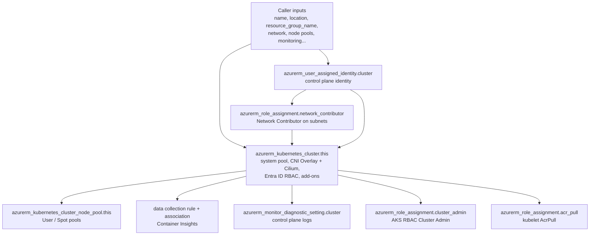

# 04 AKS module operations

| | |
|---|---|
| **Scope** | `az-infra-generic/modules/aks` and its use by `environments/dev` |
| **Status** | Implemented; module validated offline (`modules/aks/tests`: 70 plan-mode runs). Every cluster operation: **Pending external prerequisites** |
| **Code** | `modules/aks/main.tf`, `modules/aks/identity.tf`, `modules/aks/node_pools.tf`, `modules/aks/monitoring.tf`, `modules/aks/variables.tf`, `modules/aks/outputs.tf` |
| **Full reference** | [project README §9 (inputs/outputs)](../../README.md#9-aks-module-inputs-and-outputs), [§10 (examples)](../../README.md#10-usage-examples) |

## 1. Module architecture



The module never creates the resource group, virtual network, Log Analytics
workspace, Key Vault or container registry: the caller passes their IDs.
It has no provider block (the caller configures `azurerm`).

## 2. Interface summary

Operationally relevant inputs with their **module defaults** and the value
used by **dev** (`environments/dev/main.tf` + `terraform.tfvars`). The
exhaustive list (38 inputs) is in the
[project README §9](../../README.md#9-aks-module-inputs-and-outputs).

| Area | Input | Module default | dev |
|---|---|---|---|
| Identity | `name` / `location` / `resource_group_name` | required | `aks-azinfra-dev-frc` / `francecentral` / `rg-azinfra-dev-frc` |
| Tier | `sku_tier` | `Standard` | `Free` |
| Version | `kubernetes_version` | `null` (AKS default at creation) | `null` (TODO: pin `MAJOR.MINOR`) |
| Upgrades | `automatic_upgrade_channel` / `node_os_upgrade_channel` | `patch` / `NodeImage` | defaults |
| Maintenance | `maintenance_windows` | none | auto-upgrade Sunday 02:00, node OS Saturday 02:00 (`+01:00`), 4 h |
| Control plane identity | `identity_type` / `user_assigned_identity` | `UserAssigned` / created by the module | defaults |
| Access | `entra_id_rbac` | enabled, Azure RBAC on, no admin group | admin groups from `aks_admin_group_object_ids` (empty: TODO) |
| | `cluster_admin_principal_ids` | `{}` | `{ deployer = <identity running Terraform> }` (`grant_deployer_cluster_admin = true`) |
| | `local_account_disabled` / `run_command_enabled` | `true` / `false` | defaults |
| Network | `network.cni_mode` / `data_plane` / `policy` | `overlay` / `cilium` / `cilium` | defaults |
| | `network.pod_cidr` / `service_cidr` / `dns_service_ip` | `10.244.0.0/16` / `172.16.0.0/16` / `172.16.0.10` | defaults |
| | `network.outbound_type` | `loadBalancer` | default |
| | `default_node_pool.vnet_subnet_id`, `network_contributor_subnet_ids` | AKS-managed VNet / `{}` | `snet-aks-nodes` / `{ nodes = <subnet id> }` |
| API exposure | `private_cluster_enabled` / `api_server_authorized_ip_ranges` | `false` / `[]` | `false` / `[]` (TODO) |
| System pool | `default_node_pool` | `system`, `Standard_D4ds_v5`, zones 1-3, autoscale 3-5, `AzureLinux`, Managed 128 GB, CriticalAddonsOnly, surge 10 % | `Standard_D2ds_v5`, autoscale 1-3 |
| User pools | `node_pools` | `{}` | `apps`: `Standard_D4ds_v5`, autoscale 1-3, zones 1-3 |
| Security add-ons | `oidc_issuer_enabled`, `workload_identity_enabled`, `azure_policy_enabled`, `key_vault_secrets_provider`, `image_cleaner_enabled` | all enabled (rotation 2 m, image cleaner 168 h) | defaults |
| Optional security | `key_management_service`, `disk_encryption_set_id`, `microsoft_defender_enabled`, `container_registry_ids` | off | not used |
| Monitoring | `monitoring` | `null` (off) | `{ log_analytics_workspace_id = log-azinfra-dev-frc }` → Container Insights + diagnostics |

**Outputs used in operations:** `id`, `name`, `resource_group_name`,
`current_kubernetes_version`, `node_resource_group`, `node_pool_ids`,
`api_server_endpoint`, `oidc_issuer_url`, `get_credentials_command`,
`cluster_identity`, `kubelet_identity`, `key_vault_secrets_provider_identity`,
`container_insights_data_collection_rule_id`; sensitive: `kube_config_raw`,
`cluster_ca_certificate`. The dev environment re-exports a subset prefixed
`aks_` (`environments/dev/outputs.tf`); it does not re-export the raw
kubeconfig.

## 3. Behaviour to know before operating

| Topic | Behaviour |
|---|---|
| Node counts | With autoscaling, `node_count` is not managed (`null`): the autoscaler owns the size, Terraform shows no drift. Change `min_count`/`max_count` instead |
| Immutable pool settings | Changing `vm_size`, `zones`, OS disk, `max_pods`… **rotates** the pool through a temporary pool (`temporary_name_for_rotation`, generated) instead of recreating the cluster |
| Recreating changes | `dns_prefix`, `network.*` (most), `private_cluster_enabled`, `node_resource_group_name`, `disk_encryption_set_id` force a **new cluster** (plan shows `-/+ ... forces replacement`) |
| Version drift guard | Validation rejects a patch-level `kubernetes_version` with the `patch` channel and any pin with `stable`/`rapid` |
| Subnet permission order | The `Network Contributor` assignment is created **before** the cluster (`depends_on`) |
| Plan-time checks | Warnings if no User pool exists while the system pool is tainted, or if nobody can administer the cluster |
| Container Insights | Managed identity authentication through the data collection rule created by the module (the AKS API does not create it) |

## AKS-01 Create the cluster

**Status:** Pending external prerequisites.
**Purpose:** first deployment of the dev cluster with its environment resources.
**Prerequisites:** [03 BS-01 / BS-02](03-backend-and-state-management.md),
roles of [02 §2](02-prerequisites-and-setup.md#2-required-azure-permissions),
quota ([02 SETUP-07](02-prerequisites-and-setup.md#setup-07-check-regional-capacity)).
**Context:** `az-infra-generic/environments/dev`.

1. Fill the `TODO(azure-access)` values of `terraform.tfvars`: at least
   `aks_admin_group_object_ids`, ideally `api_server_authorized_ip_ranges`
   and a `kubernetes_version` from
   `az aks get-versions --location francecentral -o table` (`MAJOR.MINOR`).
2. Run the deployment lifecycle of [05 Deployment procedures](05-deployment-procedures.md) (init, validate,
   plan, apply), or the pipeline.

**Expected result:** the first plan adds **12** resources (measured on the
mocked plan of `environments/dev/tests`): resource group, VNet, subnet, Log
Analytics workspace and, in `module.aks`, the user-assigned identity, the
`Network Contributor` and `cluster_admin["deployer"]` role assignments, the
cluster, node pool `apps`, data collection rule + association and the
diagnostic setting. Cluster creation usually takes 10-20 minutes.

**Validation:**

```bash
az aks show -g rg-azinfra-dev-frc -n aks-azinfra-dev-frc \
  --query "{state:provisioningState, power:powerState.code, version:currentKubernetesVersion, sku:sku.tier}" -o table
az aks nodepool list -g rg-azinfra-dev-frc --cluster-name aks-azinfra-dev-frc \
  --query "[].{pool:name, mode:mode, count:count, min:minCount, max:maxCount, version:currentOrchestratorVersion, state:provisioningState}" -o table
```

Expected: `Succeeded`, `Running`; pools `system` (System) and `apps` (User).
Then AKS-07 to reach the API.

**Rollback:** a failed creation leaves a cluster in `Failed` state, recorded
in state or tainted: see [07 R-01 / R-03](07-troubleshooting-and-recovery.md#r-03-aks-cluster-in-failed-state).

## AKS-02 Update the cluster configuration

**Status:** Pending external prerequisites. **Context:** `environments/dev`.

1. Change `terraform.tfvars` (environment level) or the module call in
   `environments/dev/main.tf` (inputs not exposed in tfvars).
2. Plan and review with 05 DEP-04/DEP-05. Classify each change:

   | Plan symbol | Meaning | Action |
   |---|---|---|
   | `~` update in-place | AKS reconfigures the cluster | Normal review |
   | `+/-` or `-/+` with `forces replacement` on the **cluster** | New cluster: workloads and IPs lost | Stop; redesign the change or plan a migration |
   | Pool update with `temporary_name_for_rotation` | Rolling pool rotation | Schedule (pods are rescheduled) |
   | `-` destroy | Resource removed | Requires explicit `allow-destroy` in the pipeline |

3. Apply the saved plan and validate with AKS-06.

## AKS-03 Scale node pools

**Status:** Pending external prerequisites.

Pools autoscale between `min_count` and `max_count`; scaling is a change of
those bounds in `environments/dev/terraform.tfvars`:

```hcl
system_node_pool = {
  vm_size   = "Standard_D2ds_v5"
  min_count = 1
  max_count = 3   # raise to allow more system nodes
}

workload_node_pools = {
  apps = {
    vm_size   = "Standard_D4ds_v5"
    min_count = 2  # new floor
    max_count = 6  # new ceiling (check vCPU quota)
  }
}
```

Plan (in-place update of `min_count`/`max_count`), apply, then verify with the
`az aks nodepool list` command of AKS-01.

> [!NOTE]
> Do not use `az aks nodepool scale` on autoscaled pools (rejected by AKS) and
> do not disable autoscaling outside Terraform. Fixed-size pools
> (`auto_scaling_enabled = false` + `node_count`) are supported by the module
> but **not exposed** by the dev environment variables.

## AKS-04 Add or remove a user node pool

**Status:** Pending external prerequisites.

Add an entry to `workload_node_pools` (key = pool name, 1-12 lowercase
letters/digits): `vm_size`, `min_count`, `max_count`, `zones`, and optionally
`priority = "Spot"`, `node_labels`, `node_taints`
(`key=value:NoSchedule`). The pool inherits `snet-aks-nodes`. Spot pools get
the AKS spot label/taint automatically.

> [!WARNING]
> Removing an entry **deletes** the pool and evicts its pods. Drain workloads
> first; the pipeline refuses the apply unless dispatched with
> `allow-destroy: true`.

## AKS-05 Upgrade Kubernetes

**Status:** Pending external prerequisites; the minor-upgrade sequence below
must be confirmed on the first real upgrade.

**Patch versions** are applied automatically by AKS (`automatic_upgrade_channel = "patch"`)
inside the auto-upgrade maintenance window; node OS images by the
`NodeImage` channel inside the node OS window. No Terraform change is needed
and no drift appears (`MAJOR.MINOR` pin or `null`).

**Minor version upgrade** (one minor at a time):

1. List the available upgrades:

   ```bash
   az aks get-upgrades -g rg-azinfra-dev-frc -n aks-azinfra-dev-frc -o table
   ```

2. Set `kubernetes_version = "<next MAJOR.MINOR>"` in `terraform.tfvars`,
   plan (expected: in-place update of `kubernetes_version`), apply.
3. Node pools: the dev environment does not manage `orchestrator_version`
   (module input left `null`). If `az aks nodepool list` still shows the old
   `currentOrchestratorVersion`, upgrade the pools explicitly (no Terraform
   drift results, the attribute is not managed):

   ```bash
   az aks nodepool upgrade -g rg-azinfra-dev-frc --cluster-name aks-azinfra-dev-frc \
     --name system --kubernetes-version "<version>"
   az aks nodepool upgrade -g rg-azinfra-dev-frc --cluster-name aks-azinfra-dev-frc \
     --name apps --kubernetes-version "<version>"
   ```

4. **Validate:** `kubectl get nodes` shows the new version on every node;
   `terraform plan` shows no change.

**Rollback:** Kubernetes versions cannot be downgraded. Mitigate with
`kubectl` workload fixes; for a broken pool, add a new pool (AKS-04) and
remove the faulty one.

## AKS-06 Retrieve cluster information

**Status:** Pending external prerequisites. **Context:** `environments/dev`.

```bash
terraform output                                   # all non-sensitive outputs
terraform output -raw aks_api_server_endpoint
terraform output aks_cluster_identity
terraform output aks_kubelet_identity
az aks show -g rg-azinfra-dev-frc -n aks-azinfra-dev-frc -o json \
  --query "{fqdn:fqdn, version:currentKubernetesVersion, networkPlugin:networkProfile.networkPlugin, mode:networkProfile.networkPluginMode, dataplane:networkProfile.networkDataplane, oidc:oidcIssuerProfile.issuerUrl, aad:aadProfile.enableAzureRbac, localAccounts:disableLocalAccounts}"
```

Expected (dev): Azure CNI `overlay`, data plane `cilium`, Azure RBAC `true`,
local accounts disabled `true`.

## AKS-07 Configure Kubernetes access

**Status:** Pending external prerequisites.
**Prerequisites:** [02 SETUP-03](02-prerequisites-and-setup.md#setup-03-install-kubectl-and-kubelogin),
admin group membership or an *Azure Kubernetes Service RBAC* role (AKS-08).

```bash
$(terraform -chdir=az-infra-generic/environments/dev output -raw aks_get_credentials_command)
#   = az aks get-credentials --resource-group rg-azinfra-dev-frc --name aks-azinfra-dev-frc
kubelogin convert-kubeconfig -l azurecli
kubectl get nodes -o wide
```

```powershell
# PowerShell
az aks get-credentials --resource-group rg-azinfra-dev-frc --name aks-azinfra-dev-frc
kubelogin convert-kubeconfig -l azurecli
kubectl get nodes -o wide
```

**Expected result:** the nodes of `system` and `apps` are `Ready`. The
kubeconfig contains no credential (Entra ID tokens via kubelogin). The
admin kubeconfig (`--admin`) does not work: local accounts are disabled.

## AKS-08 Grant or revoke Kubernetes access

**Status:** Pending external prerequisites.

| Need | How |
|---|---|
| Cluster administrators (preferred) | Add Entra ID group object IDs to `aks_admin_group_object_ids` (tfvars), plan, apply |
| Bootstrap access for the deploying identity | `grant_deployer_cluster_admin = true` (dev default); set `false` once admin groups exist |
| Namespace-scoped access | Azure RBAC role assignment on the namespace scope (not managed by Terraform): |

```bash
CLUSTER_ID="$(terraform -chdir=az-infra-generic/environments/dev output -raw aks_id)"
az role assignment create --role "Azure Kubernetes Service RBAC Writer" \
  --assignee-object-id "<group-object-id>" --assignee-principal-type Group \
  --scope "${CLUSTER_ID}/namespaces/<namespace>"
```

Revoke by removing the object ID from tfvars (plan shows the role assignment
or admin group change) or `az role assignment delete` for manual ones.
Access reviews: [08 SEC-08](08-security-and-maintenance.md#sec-08-review-access).

## AKS-09 Destroy AKS resources safely

**Status:** Pending external prerequisites.

> [!CAUTION]
> Destroying the cluster deletes every workload, persistent disk created by
> the cluster and the AKS-managed node resource group. Export what must be
> kept (manifests, volume data) first.

* **Whole environment:** [05 DEP-10](05-deployment-procedures.md#dep-10-destroy-the-environment).
* **Cluster only** (keeps the VNet and Log Analytics workspace), exceptional
  use of `-target`:

  ```bash
  terraform plan -destroy -target=module.aks -out=destroy-aks.tfplan
  terraform show destroy-aks.tfplan | grep -E "will be destroyed" | sort
  terraform apply destroy-aks.tfplan
  ```

  Expected: only `module.aks.*` resources. Follow with a normal
  `terraform plan` (it proposes to recreate them while the module call exists).

**Validation:** `az aks show -g rg-azinfra-dev-frc -n aks-azinfra-dev-frc`
returns `ResourceNotFound`; the `MC_` node resource group is gone.

## 4. Consuming the module in another project

**Status:** Implemented (examples planned and validated offline in a temporary
harness, see the [project README §12](../../README.md#12-validation-commands)).

```hcl
module "aks" {
  source = "git::https://<git-host>/<org>/azure-infra.git//az-infra-generic/modules/aks?ref=<tag-or-commit>"

  name                = "aks-<project>-<env>-<region>"
  location            = "<region>"
  resource_group_name = azurerm_resource_group.this.name

  default_node_pool              = { vnet_subnet_id = azurerm_subnet.aks_nodes.id }
  network_contributor_subnet_ids = { nodes = azurerm_subnet.aks_nodes.id }
  node_pools                     = { apps = { vm_size = "Standard_D4ds_v5" } }

  entra_id_rbac = { admin_group_object_ids = ["<aks-admins-group-object-id>"] }
  monitoring    = { log_analytics_workspace_id = azurerm_log_analytics_workspace.this.id }
}
```

Pin `ref` to a commit (no release tags exist yet: module versioning is
*Planned*, see [08 SEC-05](08-security-and-maintenance.md#sec-05-version-the-aks-module)). A production-like example
(private cluster, NAT egress, KMS, Defender) is in the
[project README §10](../../README.md#10-usage-examples).

## 5. Implementation status of features

| Feature | Status |
|---|---|
| User-assigned or system-assigned control plane identity, bring-your-own identity | Implemented |
| Entra ID integration, Azure RBAC, admin groups, local accounts disabled | Implemented |
| Azure CNI Overlay / VNet mode, Cilium / Azure data plane, Cilium/Calico/Azure policy | Implemented |
| Private cluster, authorized IP ranges, load balancer / managed NAT / user NAT / UDR egress | Implemented |
| System pool, User/System/Spot pools, autoscaling, zones, taints, labels, pool rotation | Implemented |
| Workload Identity, Azure Policy, Key Vault CSI driver, Image Cleaner | Implemented |
| KMS etcd encryption, disk encryption set, Defender, AcrPull | Implemented (not used by dev) |
| Container Insights (DCR), control plane diagnostics | Implemented |
| Windows node pools | Not implemented |
| Managed Prometheus / Grafana, Istio, application routing, API server VNet integration, Node Auto-Provisioning, bring-your-own kubelet identity | Not implemented |
| Fixed-size pools and `orchestrator_version` in the dev environment | Not exposed (module supports them) |

## References

* Code: `modules/aks/`, `environments/dev/main.tf`, `environments/dev/terraform.tfvars`
* Module README: `modules/aks/README.md`
* [01 Architecture §5](01-architecture.md#5-aks-module-architecture)
