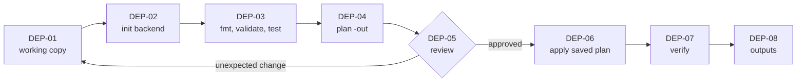

# 05 Deployment procedures

| | |
|---|---|
| **Scope** | Terraform lifecycle of `environments/<env>` (dev implemented) |
| **Status** | Offline steps (format, validate, test) **Validated**; plan/apply/verify/destroy **Pending external prerequisites** |
| **Execution modes** | Local (this document) or pipeline (06 CI/CD operations). Production changes go through the pipeline only |

## 1. Lifecycle



All commands run from `az-infra-generic/environments/dev` unless stated
otherwise, with the authentication of
[02 SETUP-04](02-prerequisites-and-setup.md#setup-04-authenticate-interactively-operator).

## DEP-01 Prepare a working copy

**Status:** Implemented.

```bash
git switch main && git pull --ff-only
git switch -c "<change-branch>"      # every change goes through a pull request
cd az-infra-generic/environments/dev
```

Never apply from a branch that is not merged (or about to be) into `main`:
the pipeline is the reference, and a local apply of unmerged code creates
drift that the next pipeline run reverts.

## DEP-02 Initialize

**Status:** Pending external prerequisites.

```bash
terraform init -backend-config=backend.hcl -lockfile=readonly
```

Expected: backend `azurerm` configured, `azurerm v5.14.0` from the lock file.
Details and errors: [03 BS-05](03-backend-and-state-management.md#bs-05-initialize-an-environment-against-the-backend).

## DEP-03 Format, validate and test

**Status:** Validated.

```bash
terraform fmt -check -recursive ../..     # whole project
terraform validate
terraform test                            # offline, mocked provider
```

Expected: no file listed by `fmt`, `Success! The configuration is valid.`,
`Success! 2 passed, 0 failed.` For the full pipeline gates from the
repository root: `ci/scripts/run-local.sh az-infra-generic`.

## DEP-04 Plan

**Status:** Pending external prerequisites.

```bash
terraform plan -out=dev.tfplan -detailed-exitcode
echo "exit code: $?"
```

| Exit code | Meaning |
|---|---|
| 0 | No change |
| 1 | Error (see the message; 07 Troubleshooting and recovery) |
| 2 | Changes present, saved in `dev.tfplan` |

`dev.tfplan` contains sensitive values: keep it local, delete it after use
(`*.tfplan` is ignored by Git).

## DEP-05 Review the plan

**Status:** Pending external prerequisites.

```bash
terraform show dev.tfplan | less
terraform show dev.tfplan | grep -E "will be (destroyed|replaced)|must be replaced|forces replacement"
```

Same destructive-change report as the pipeline (from the repository root):

```bash
terraform -chdir=az-infra-generic/environments/dev show -json dev.tfplan > /tmp/dev-plan.json
python3 ci/scripts/ci.py plan-report /tmp/dev-plan.json --title "az-infra-generic/dev"
rm -f /tmp/dev-plan.json      # contains sensitive values in clear text
```

Review checklist:

* Only the intended resources change; counts match the change request.
* No `forces replacement` on `module.aks.azurerm_kubernetes_cluster.this`
  (see [04 §3](04-aks-module-operations.md#3-behaviour-to-know-before-operating)).
* Deletions/replacements are expected and authorized.
* Role assignment changes are expected (access is affected).

## DEP-06 Apply the reviewed plan

**Status:** Pending external prerequisites.

```bash
terraform apply dev.tfplan
```

Applying the saved file applies exactly what was reviewed, without a second
confirmation. Terraform refuses it (`Saved plan is stale`) if the state
changed since the plan: re-run DEP-04.

**Expected result:** `Apply complete! Resources: N added, M changed, D destroyed.`
matching the plan. **Rollback:** see 07 Troubleshooting and recovery (failed
or partial apply).

## DEP-07 Verify the deployed resources

**Status:** Pending external prerequisites.

```bash
terraform plan -detailed-exitcode          # expect exit code 0: no drift after apply
az resource list -g rg-azinfra-dev-frc --query "[].{name:name, type:type}" -o table
az aks show -g rg-azinfra-dev-frc -n aks-azinfra-dev-frc --query "{state:provisioningState, power:powerState.code}" -o table
$(terraform output -raw aks_get_credentials_command) && kubelogin convert-kubeconfig -l azurecli
kubectl get nodes
kubectl get pods -n kube-system
az monitor diagnostic-settings list --resource "$(terraform output -raw aks_id)" --query "[].name" -o tsv
```

Expected: no drift; the resources of [01 §3.2](01-architecture.md#32-resources-of-the-dev-environment);
`Succeeded`/`Running`; nodes `Ready`; system pods `Running`; diagnostic
setting `diag-aks-azinfra-dev-frc`. Container Insights data appears in the
workspace after about 10 minutes (`ContainerLogV2`, `KubePodInventory` tables).

## DEP-08 Inspect outputs

**Status:** Pending external prerequisites.

```bash
terraform output                         # every non-sensitive output
terraform output -json aks_cluster_identity
terraform output -raw aks_oidc_issuer_url
```

| Output | Use |
|---|---|
| `aks_id`, `aks_name`, `resource_group_name` | Role assignments, CLI commands |
| `aks_api_server_endpoint`, `aks_get_credentials_command` | Cluster access |
| `aks_oidc_issuer_url` | Workload Identity federated credentials |
| `aks_cluster_identity`, `aks_kubelet_identity` | Extra role assignments (e.g. AcrPull) |
| `virtual_network_id`, `aks_nodes_subnet_id`, `log_analytics_workspace_id` | Peering, other workloads, queries |

## DEP-09 Manage changes

**Status:** Implemented (process).

1. Branch (DEP-01), change code or `terraform.tfvars`.
2. Run DEP-03 locally.
3. Open a pull request: the pipeline runs the quality gates and, once Azure
   is enabled, a dev plan whose summary reviewers read.
4. Merge to `main`: the pipeline plans and waits for the `azure-dev` approval
   before applying the reviewed plan.
5. Local applies (DEP-04..06) are for dev only, when the pipeline is not yet
   enabled or for incidents; record them in the pull request.

## DEP-10 Destroy the environment

**Status:** Pending external prerequisites.

> [!CAUTION]
> Deletes the cluster, its workloads and disks, the VNet and the Log Analytics
> workspace (logs included). Never on an environment others depend on without
> an agreed decommissioning.

```bash
terraform plan -destroy -out=destroy.tfplan
terraform show destroy.tfplan | grep -c "will be destroyed"     # 12 for dev
terraform apply destroy.tfplan
```

**Validation:** `az group exists -n rg-azinfra-dev-frc` returns `false`;
`terraform state list` is empty. The state blob remains (empty state) and its
versions stay recoverable for 30 days.

**Troubleshooting:** `deleting Resource Group ... contains resources that are
not managed by Terraform` comes from
`prevent_deletion_if_contains_resources = true`: inspect them with
`az resource list -g rg-azinfra-dev-frc -o table`, remove or import them, then
re-run. A Log Analytics workspace is soft-deleted; recreating one with the
same name in the same resource group recovers it.

## DEP-11 Create another environment (rec, ppr, prod)

**Status:** Not implemented (procedure only). Follow the
[project README §2](../../README.md#adding-an-environment-rec-ppr-prod):
copy `environments/dev`, set `container_name = "tfstate-<env>"` in
`backend.tf`, non-overlapping address space, `aks_sku_tier = "Standard"`,
real admin groups, `grant_deployer_cluster_admin = false`. Then add the
deployment to `ci/projects/az-infra-generic.json` so the pipeline's Azure
static checks cover it, and create its GitHub environments.

## References

* [03 Backend and state management](03-backend-and-state-management.md)
* [04 AKS module operations](04-aks-module-operations.md)
* Code: `environments/dev/`, `ci/scripts/ci.py` (plan report)
