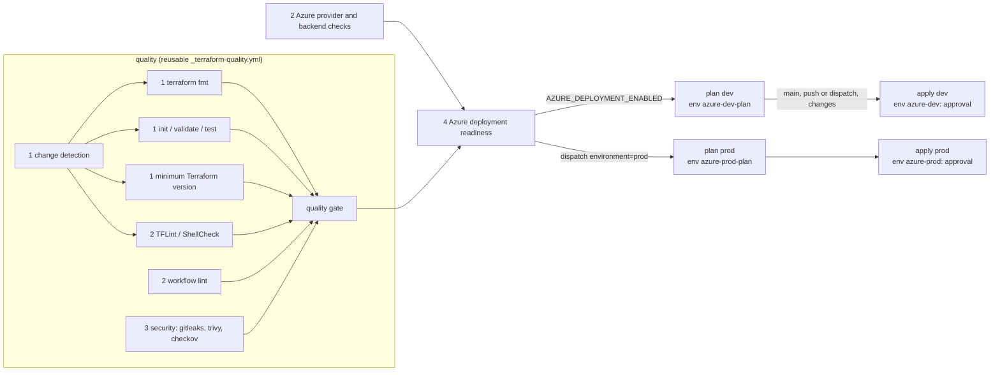

# 06 CI/CD operations

| | |
|---|---|
| **Scope** | GitHub Actions pipeline of `az-infra-generic` |
| **Status** | Workflows **Implemented**, not yet executed on GitHub (repository not pushed when written). Azure stages: **Pending external prerequisites** (disabled until CI-01) |
| **Code** | `.github/workflows/az-infra-generic.yml`, `.github/workflows/_terraform-quality.yml`, `.github/workflows/_terraform-plan.yml`, `.github/workflows/_terraform-apply.yml`, `ci/scripts/` |
| **Design reference** | [docs/ci-cd.md](../../../docs/ci-cd.md) (architecture, tool choices, security policy, GitHub configuration) |

## 1. Pipeline at a glance



| Trigger | Runs |
|---|---|
| Pull request touching `az-infra-generic/**`, `ci/**`, shared workflows | Quality gates on the affected roots, Azure static checks; dev plan for same-repository PRs (when enabled) |
| Push to `main` (same paths) | Quality gates on every root, Azure static checks, dev plan → approval → apply (when enabled) |
| `workflow_dispatch` (`environment`: dev/prod, `allow-destroy`) | Same as push for the chosen environment |
| Schedule (Monday 05:17 UTC) | Full validation, security re-scan, dev plan as drift report (no apply) |

## 2. Checks that must pass before a deployment is authorized

An apply job only starts when **all** of these succeeded, in this order:

| # | Check (job name in GitHub) | Blocking condition |
|---|---|---|
| 1 | `quality / 1 · terraform fmt` | Unformatted file |
| 2 | `quality / 1 · init / validate / test (<root>)` | Init with read-only lock file, validate or `terraform test` failure |
| 3 | `quality / 1 · minimum Terraform version (modules/aks)` | Failure with Terraform 1.9.8 |
| 4 | `quality / 2 · TFLint / ShellCheck`, `quality / 2 · workflow lint` | Any lint finding of severity ≥ warning; CI unit tests |
| 5 | `quality / 3 · security (gitleaks, trivy, checkov)` | Any secret; HIGH/CRITICAL misconfiguration not accepted; failed Checkov policy not accepted |
| 6 | `quality / quality gate` | Any of the above failed or was cancelled |
| 7 | `2 · Azure provider & backend checks` | Credentials or hardcoded IDs in code, backend isolation/auth violations, incomplete lock file |
| 8 | `4 · Azure deployment readiness` | `AZURE_DEPLOYMENT_ENABLED` is not `true` (Azure stages skipped, not failed) |
| 9 | `plan dev / 4 · plan …` | Plan error, failed plan-level Checkov policy |
| 10 | Environment approval (`azure-dev` / `azure-prod`) | Not approved by a required reviewer |
| 11 | Apply guard (`ci.py apply-guard`) | Not on `main`, not push/dispatch, plan from another commit, destructive plan without `allow-destroy` |
| 12 | `terraform apply <saved plan>` | Stale plan (state changed after review) |

Accepting a scanner finding instead of fixing it is a reviewed change to
`.checkov.yaml` / `.trivyignore.yaml` ([docs/ci-cd.md §5](../../../docs/ci-cd.md#5-security-policy)).

## CI-01 Enable the Azure stages (one-time)

**Status:** Pending external prerequisites.
**Prerequisites:** backend bootstrapped ([03 BS-01](03-backend-and-state-management.md#bs-01-bootstrap-the-backend)),
`backend.hcl` committed (BS-02), *Owner* or *User Access Administrator* on the
subscription, repository admin on GitHub, `gh auth login` done.

1. Create the two identities of dev (names are yours to choose; the
   resource group holding them is not managed by this project):

   ```bash
   RG_ID="<identities-resource-group>"
   for id in "<plan-identity-name>" "<deploy-identity-name>"; do
     az identity create -g "$RG_ID" -n "$id" -l francecentral
   done
   ```

2. Federate each identity with **its** GitHub environment:

   ```bash
   az identity federated-credential create -g "$RG_ID" --identity-name "<plan-identity-name>" \
     --name github-azure-dev-plan --issuer https://token.actions.githubusercontent.com \
     --subject "repo:<owner>/<repository>:environment:azure-dev-plan" --audiences api://AzureADTokenExchange
   az identity federated-credential create -g "$RG_ID" --identity-name "<deploy-identity-name>" \
     --name github-azure-dev --issuer https://token.actions.githubusercontent.com \
     --subject "repo:<owner>/<repository>:environment:azure-dev" --audiences api://AzureADTokenExchange
   ```

3. Assign roles (least privilege, [docs/ci-cd.md §6](../../../docs/ci-cd.md#6-deployment-authorization)):

   ```bash
   SUB="/subscriptions/<SUBSCRIPTION_ID>"
   PLAN_OID="$(az identity show -g "$RG_ID" -n "<plan-identity-name>" --query principalId -o tsv)"
   DEPLOY_OID="$(az identity show -g "$RG_ID" -n "<deploy-identity-name>" --query principalId -o tsv)"
   DEV_CONTAINER_ID="<state_containers.dev.id from the bootstrap outputs>"

   az role assignment create --assignee-object-id "$PLAN_OID" --assignee-principal-type ServicePrincipal --role "Reader" --scope "$SUB"
   az role assignment create --assignee-object-id "$PLAN_OID" --assignee-principal-type ServicePrincipal --role "Azure Kubernetes Service Cluster User Role" --scope "$SUB"
   az role assignment create --assignee-object-id "$PLAN_OID" --assignee-principal-type ServicePrincipal --role "Storage Blob Data Reader" --scope "$DEV_CONTAINER_ID"

   az role assignment create --assignee-object-id "$DEPLOY_OID" --assignee-principal-type ServicePrincipal --role "Contributor" --scope "$SUB"
   az role assignment create --assignee-object-id "$DEPLOY_OID" --assignee-principal-type ServicePrincipal --role "Role Based Access Control Administrator" --scope "$SUB"
   ```

   Grant the deploy identity *Storage Blob Data Contributor* on `tfstate-dev`
   through the bootstrap ([03 BS-03](03-backend-and-state-management.md#bs-03-grant-a-cicd-identity-access-to-one-environments-state)).
   Consider restricting *Role Based Access Control Administrator* with a
   condition limiting assignable roles to *Network Contributor*, *Azure
   Kubernetes Service RBAC Cluster Admin* and *AcrPull*.

4. Create the GitHub environments (reviewers, `main` only for `azure-dev`):

   ```bash
   REPO="<owner>/<repository>"
   REVIEWER_ID="$(gh api users/<reviewer-login> --jq .id)"
   gh api -X PUT "repos/$REPO/environments/azure-dev-plan"
   gh api -X PUT "repos/$REPO/environments/azure-dev" --input - <<EOF
   {"reviewers":[{"type":"User","id":$REVIEWER_ID}],"prevent_self_review":false,
    "deployment_branch_policy":{"protected_branches":false,"custom_branch_policies":true}}
   EOF
   gh api -X POST "repos/$REPO/environments/azure-dev/deployment-branch-policies" -f name=main -f type=branch
   ```

5. Set the variables (identifiers, not secrets):

   ```bash
   for env in azure-dev-plan azure-dev; do
     gh variable set AZURE_TENANT_ID --env "$env" --body "<TENANT_ID>" -R "$REPO"
     gh variable set AZURE_SUBSCRIPTION_ID --env "$env" --body "<SUBSCRIPTION_ID>" -R "$REPO"
   done
   gh variable set AZURE_CLIENT_ID --env azure-dev-plan --body "<plan-identity-client-id>" -R "$REPO"
   gh variable set AZURE_CLIENT_ID --env azure-dev --body "<deploy-identity-client-id>" -R "$REPO"
   gh variable set AZURE_DEPLOYMENT_ENABLED --body true -R "$REPO"
   ```

**Validation:** run CI-03 with `gh workflow run`; the `plan dev` job
authenticates (no `Azure authentication not configured` error) and posts a
plan summary. **Rollback:** `gh variable set AZURE_DEPLOYMENT_ENABLED --body false`
disables every Azure job immediately.

## CI-02 Validate a change (pull request)

**Status:** Implemented, not yet executed on GitHub.

1. Push a branch and open a pull request.
2. Follow the run: `gh pr checks --watch` or the *Checks* tab.
3. All checks of §2 rows 1-7 must be green; the run summary lists the gate
   results and, for same-repository PRs with Azure enabled, the dev plan.

A pull request **never** applies anything. Fork pull requests never receive
Azure tokens (the plan job is skipped for them).

## CI-03 Deploy dev

**Status:** Pending external prerequisites (CI-01).

* Merge the pull request to `main`, **or** dispatch manually:

  ```bash
  gh workflow run az-infra-generic.yml --ref main -f environment=dev -f allow-destroy=false
  gh run list --workflow az-infra-generic.yml --limit 5
  gh run watch "<run-id>"
  ```

* `plan dev` runs; if it reports changes, `apply dev` waits for the
  `azure-dev` approval (CI-05).
* **Expected result:** `apply dev` succeeds and its summary lists the
  non-sensitive outputs. **Validation:** [05 DEP-07](05-deployment-procedures.md#dep-07-verify-the-deployed-resources).

## CI-04 Review a plan

**Status:** Pending external prerequisites.

1. Read the run summary: change counts (create / update / replace / delete)
   and the **destructive changes** warning listing each affected address.
2. For details, download the plan artifact (5-day retention):

   ```bash
   gh run download "<run-id>" -n tfplan-az-infra-generic-environments-dev-dev -D ./plan-review
   less ./plan-review/tfplan.txt                # human-readable plan, sensitive values masked
   cat ./plan-review/plan-meta.json             # commit, counts, destructive addresses
   rm -rf ./plan-review                         # the binary plan contains sensitive values
   ```

3. Apply the checklist of [05 DEP-05](05-deployment-procedures.md#dep-05-review-the-plan).

## CI-05 Approve or reject a deployment

**Status:** Pending external prerequisites.

In the run page: **Review deployments** → select `azure-dev` → *Approve and
deploy* or *Reject* (with a comment). Only the environment's reviewers can
approve. Rejection ends the run without applying; nothing changes in Azure.

## CI-06 Authorize a destructive change

**Status:** Pending external prerequisites.

A plan that deletes or replaces resources makes `apply dev` fail at the guard
(`the plan deletes or replaces resources (...)`), even after approval.

1. Confirm the deletions are intended (CI-04).
2. Re-run with explicit authorization:

   ```bash
   gh workflow run az-infra-generic.yml --ref main -f environment=dev -f allow-destroy=true
   ```

3. Review the new plan and approve (CI-05).

## CI-07 Deploy prod

**Status:** Not implemented. `environments/prod` does not exist; the
`plan prod` job fails explicitly (`does not exist (environment not
implemented yet?)`). Once the root exists (05 DEP-11) and its identities and
environments `azure-prod-plan` / `azure-prod` are configured like CI-01
(recommended: ≥ 2 reviewers, *prevent self-review*):

```bash
gh workflow run az-infra-generic.yml --ref main -f environment=prod -f allow-destroy=false
```

Production plans are checked with the stricter `.checkov-prod.yaml`.

## CI-08 Drift detection

**Status:** Pending external prerequisites. The weekly schedule plans dev
without applying. A summary showing changes on an unchanged `main` means
**drift**: someone changed Azure outside Terraform. Handle it with
08 Security and maintenance (drift procedure).

## CI-09 Investigate a failed run

**Status:** Implemented.

```bash
gh run list --workflow az-infra-generic.yml --status failure --limit 5
gh run view "<run-id>" --log-failed
gh run download "<run-id>" -n security-reports-az-infra-generic -D ./reports   # SARIF + tables
```

Identify the failing job in §2, then use the table below or
[docs/ci-cd.md §12](../../../docs/ci-cd.md#12-troubleshooting).

| Failing job | First action |
|---|---|
| `terraform fmt` | `terraform fmt -recursive az-infra-generic`, commit |
| `init / validate / test` | Reproduce: `ci/scripts/terraform-checks.sh az-infra-generic root <root>` |
| `minimum Terraform version` | A feature newer than 1.9 is used: raise `required_version` or avoid it |
| `TFLint / ShellCheck` | Reproduce: `ci/scripts/lint.sh az-infra-generic tflint` |
| `security` | Read the reports; fix, or accept with justification (never lower thresholds) |
| `Azure provider & backend checks` | Reproduce: `python3 ci/scripts/ci.py azure-config az-infra-generic` |
| `plan dev` | Authentication / backend / quota errors: 07 Troubleshooting and recovery |
| `apply dev` refused by the guard | Wrong branch, other commit, or destructive plan: CI-06 |

## CI-10 Run the gates locally

**Status:** Validated (offline gates). **Context:** repository root, Linux / WSL / Git Bash.

```bash
ci/scripts/install-tools.sh                 # Linux x86_64: pinned, checksum-verified scanners
ci/scripts/run-local.sh az-infra-generic
python3 -m unittest discover -s ci/tests
```

## CI-11 Re-run, cancel and concurrency

**Status:** Implemented.

* Re-run failed jobs: `gh run rerun "<run-id>" --failed`. A re-run of an apply
  re-uses the plan artifact of the same run (refused if stale).
* Pull request runs are cancelled by newer pushes; runs on `main` are not.
* Applies are serialized per environment and **never cancelled**
  automatically. Cancelling an apply manually can leave a state lock:
  [03 BS-10](03-backend-and-state-management.md#bs-10-release-a-stuck-state-lock).

## References

* [docs/ci-cd.md](../../../docs/ci-cd.md): design, security policy (§5), authorization (§6), configuration (§10), troubleshooting (§12)
* Scripts: `ci/scripts/tf-plan.sh`, `ci/scripts/tf-apply.sh`, `ci/scripts/ci.py`
