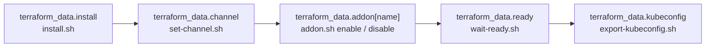
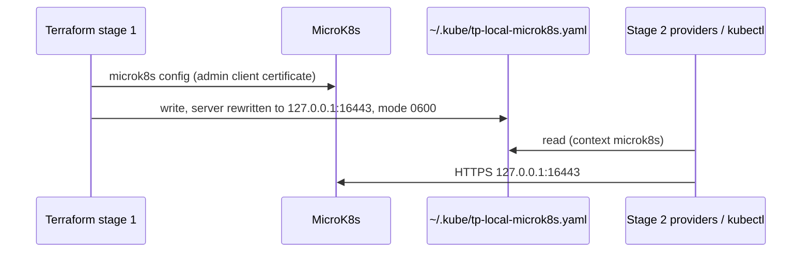

# 01 Architecture

| | |
|---|---|
| **Scope** | `tp-local`: Windows host, WSL2 Ubuntu, MicroK8s, Terraform stages 1 and 2 |
| **Status** | Implemented and validated offline; not yet executed on a WSL distribution |
| **Source of truth** | `tp-local/bootstrap`, `tp-local/environments/dev`, `tp-local/modules/*`, `tp-local/scripts` |

## 1. Purpose and scope

`tp-local` builds a single-node Kubernetes cluster on a Windows workstation
for local DevOps experiments, entirely described as code:

* **Stage 1, `bootstrap/`**: installs and configures MicroK8s inside WSL
  Ubuntu (snap channel, add-ons, readiness, kubeconfig) through the
  `microk8s` module.
* **Stage 2, `environments/dev/`**: manages Kubernetes resources
  (namespaces, RBAC, quotas, network policies, storage, node labels) and Helm
  releases through the Kubernetes and Helm providers.

Out of scope: multi-node or high-availability clusters, Windows containers,
remote access from other machines, `environments/rec` (empty directory).

## 2. Layers and ownership

```mermaid
flowchart TB
    subgraph WIN["Windows host"]
        PS["PowerShell<br/>wsl.exe, Test-WslHost.ps1"]
        WSLCFG[".wslconfig<br/>memory, CPUs"]
        subgraph VM["WSL2 utility VM"]
            subgraph UB["Ubuntu-24.04 distribution (systemd)"]
                PREP["prepare-wsl.sh<br/>snapd, Terraform"]
                TF1["Terraform stage 1<br/>tp-local/bootstrap"]
                TF2["Terraform stage 2<br/>tp-local/environments/dev"]
                subgraph MK["MicroK8s snap 1.35/stable"]
                    API["API server<br/>127.0.0.1:16443"]
                    ADD["Add-ons<br/>dns, rbac, hostpath-storage,<br/>metrics-server, ingress"]
                end
                KCFG["~/.kube/tp-local-microk8s.yaml"]
                STATE["~/.local/state/tp-local/*.tfstate"]
            end
        end
    end
    PS -->|"wsl --install, --shutdown"| UB
    WSLCFG -.-> VM
    PREP --> TF1
    TF1 -->|"scripts: snap, microk8s"| MK
    TF1 -->|"export"| KCFG
    TF2 -->|"kubernetes and helm providers"| KCFG
    KCFG --> API
    TF1 --> STATE
    TF2 --> STATE
```

| Layer | Managed by | Mechanism | Status |
|---|---|---|---|
| WSL2, distribution, `.wslconfig` | Operator (Windows) | `wsl.exe`, manual | Pending external prerequisites |
| systemd, snapd, Terraform, kubectl/helm (optional) | `scripts/wsl/prepare-wsl.sh` | Idempotent bash, `sudo` | Implemented |
| MicroK8s install, channel, add-ons, readiness, kubeconfig | Terraform stage 1 | `terraform_data` + scripts in `modules/microk8s/scripts` | Implemented, validated offline |
| Namespaces, RBAC, quotas, network policies, StorageClass, node labels | Terraform stage 2 | `hashicorp/kubernetes` 3.5 (`*_v1` resources) | Implemented, validated offline |
| Helm releases | Terraform stage 2 (`helm.tf`) | `hashicorp/helm` 3.3 | Implemented, validated offline |
| Application images, workload manifests outside `helm_releases` | Operator | kubectl / Helm CLI | Not managed |

**Why two stages:** the Kubernetes provider must not be configured from
resources created in the same apply. Stage 1 creates the cluster and writes a
kubeconfig; stage 2 reads it in a separate apply.

**Why scripts for MicroK8s:** no Terraform provider manages snaps or WSL.
Each step is an idempotent script run at **apply** time only; `terraform plan`
never touches the machine.

## 3. Stage 1: the `microk8s` module



| Step (`module.microk8s.…`) | On create | On destroy | Re-runs when |
|---|---|---|---|
| `terraform_data.install` | Preflight; `snap install microk8s --classic --channel=…` if absent; adds the user to group `microk8s`; waits for readiness | `snap remove --purge` **only if** `uninstall_on_destroy = true` | Never (use `-replace`) |
| `terraform_data.channel` | `snap refresh --channel` if the tracked channel differs | — | `microk8s_channel` changes |
| `terraform_data.addon["<name>"]` | `microk8s enable <name> <args>` (serialized by a lock) | `microk8s disable <name>` answering "n" to data deletion | Install re-run or arguments change |
| `terraform_data.ready` | Services up, node Ready, every Deployment Available, every DaemonSet rolled out | — | Install, channel or add-on set changes |
| `terraform_data.kubeconfig` | Writes the admin kubeconfig (0600) with server `127.0.0.1:16443` | Removes the file | Install/channel change, path or address change |

Root privileges: only `snap install/refresh/remove` and `usermod` need them,
through non-interactive `sudo -n` (credentials cached with `sudo -v`).
Details: `modules/microk8s/README.md`.

## 4. Stage 2: Kubernetes and Helm

| Object | Terraform address | Purpose |
|---|---|---|
| Nodes (read) | `data.kubernetes_nodes.all` | Connectivity check at plan time, node health output |
| Namespaces `apps`, `sandbox` | `module.namespaces["<ns>"].kubernetes_namespace_v1.this` | Pod Security Admission labels |
| Namespace baseline | `module.namespaces["<ns>"].*` | default SA without token, quota, limits, network policies, SAs, role bindings |
| StorageClass | `kubernetes_storage_class_v1.hostpath_retain[0]` | `microk8s-hostpath-retain` (Retain, WaitForFirstConsumer) |
| Node labels | `kubernetes_labels.nodes["<node>"]` | `tp-local/role = dev` |
| Helm releases | `helm_release.this["<release>"]` | `podinfo` 6.17.0 in `apps` |

## 5. Kubeconfig and API access



* The WSL IP changes at each restart; `127.0.0.1` is part of the API server
  certificate SANs and stays valid.
* The kubeconfig is **cluster-admin**: keep it out of repositories (it lives
  in `~/.kube`), mode 0600.
* Windows tools reach `127.0.0.1:16443` through WSL localhost forwarding.

## 6. Terraform state

| Root | State file | Backend |
|---|---|---|
| `bootstrap` | `~/.local/state/tp-local/bootstrap.tfstate` | `local`, path given by `scripts/tf-init.sh` |
| `environments/dev` | `~/.local/state/tp-local/environments-dev.tfstate` | same |

The directory is outside the repository (mode 0700) so that interactive runs
and a self-hosted runner using the same Linux user share **one** state per
machine. Override with `TP_LOCAL_STATE_DIR`. A plain `terraform init` without
the script would create a second, diverging state in the root directory.

## 7. MicroK8s add-ons

| Add-on | Managed | Provides |
|---|---|---|
| `dns` | Yes (default) | CoreDNS service discovery |
| `rbac` | Yes | RBAC authorization (makes stage 2 RoleBindings effective) |
| `hostpath-storage` | Yes | Dynamic PersistentVolumes, StorageClass `microk8s-hostpath` |
| `metrics-server` | Yes | `kubectl top`, HPA metrics |
| `ingress` | Yes | NGINX ingress controller, namespace `ingress`, class `public`, hostPorts 80/443 |
| `registry`, `dashboard`, `observability`, `cert-manager`, `metallb` | Opt-in through the `addons` variable | Not enabled by default (reasons in the [project README §7](../../README.md#7-modules-and-add-ons)) |

Add-ons enabled by MicroK8s itself and not listed in `addons` are left untouched.

## 8. Execution order and dependencies

| Order | Action | Requires |
|---|---|---|
| 1 | Windows: WSL2 + `Ubuntu-24.04`, resources | Windows admin (install only) |
| 2 | WSL (sudo): `prepare-wsl.sh` (systemd, snapd, Terraform) | Internet access |
| 3 | Stage 1 apply | `sudo -v` (first install, channel changes) |
| 4 | Stage 2 apply | Stage 1 applied, kubeconfig present, cluster running |
| 5 | Verification `scripts/verify-cluster.sh` | Stages 1-2 applied |

Destruction runs in the reverse order (stage 2, then stage 1).

## 9. External dependencies

| Dependency | Used for |
|---|---|
| Snap Store (`api.snapcraft.io`) | MicroK8s snap and refreshes |
| Container registries (`registry.k8s.io`, `docker.io`, `ghcr.io`, …) | Add-on and podinfo images |
| `apt.releases.hashicorp.com` | Terraform package |
| `registry.terraform.io` | Kubernetes/Helm providers |
| `stefanprodan.github.io/podinfo` | podinfo chart |
| `localtest.me` public DNS (resolves to 127.0.0.1) | Smoke-test host name |

## 10. References

* [Project README](../../README.md) (architecture §1, troubleshooting §10, limitations §11)
* Module READMEs: `modules/microk8s/README.md`, `modules/k8s-namespace/README.md`
* [Pipeline documentation](../../../docs/ci-cd.md)
