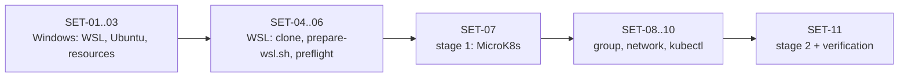

# 02 WSL initial setup

| | |
|---|---|
| **Scope** | Preparing a new workstation and bootstrapping the local cluster for the first time |
| **Status** | SET-01 **Validated** on the authoring host (it reported the missing distribution). All other steps: **Pending external prerequisites** (no WSL distribution was available) |
| **Code** | `scripts/host/Test-WslHost.ps1`, `scripts/host/wslconfig.example`, `scripts/wsl/prepare-wsl.sh`, `scripts/tf-init.sh`, `bootstrap/` |



## SET-01 Check the Windows host

**Status:** Validated. **Context:** PowerShell (no elevation), repository root.

```powershell
.\tp-local\scripts\host\Test-WslHost.ps1                 # default distribution Ubuntu-24.04
.\tp-local\scripts\host\Test-WslHost.ps1 -Distribution Ubuntu-24.04
```

**Expected result:** `[OK  ] WSL present`, `[OK  ] Distribution 'Ubuntu-24.04' runs as WSL 2`,
`.wslconfig` reported; exit code 0. A `[FAIL]` line names the missing step
(SET-02 or SET-03). The script only reads; it changes nothing.

## SET-02 Install WSL and the Ubuntu distribution

**Status:** Pending external prerequisites.
**Prerequisites:** Windows 10 22H2+ or Windows 11, hardware virtualization
enabled. **Context:** PowerShell, **administrator** for the first command.

```powershell
wsl --install --no-distribution     # only if WSL itself is missing (reboot if asked)
wsl --update
wsl --install -d Ubuntu-24.04       # opens Ubuntu: create your Linux user and password
wsl --list --verbose                # VERSION must be 2
wsl --set-default Ubuntu-24.04
```

If the distribution shows version 1: `wsl --set-version Ubuntu-24.04 2`.

**Validation:** rerun SET-01: no `[FAIL]` line.

## SET-03 Configure WSL resources

**Status:** Pending external prerequisites. **Context:** PowerShell (user).

MicroK8s with its add-ons and a few workloads needs about 6-8 GB of RAM and
4 CPUs. `%UserProfile%\.wslconfig` applies to every WSL2 distribution.

```powershell
if (-not (Test-Path "$env:USERPROFILE\.wslconfig")) {
    Copy-Item .\tp-local\scripts\host\wslconfig.example "$env:USERPROFILE\.wslconfig"
} else {
    notepad "$env:USERPROFILE\.wslconfig"     # merge the [wsl2] values by hand
}
wsl --shutdown                                 # applies the new limits
```

**Validation (WSL):** `free -h` and `nproc` show the configured memory and CPUs.

## SET-04 Get the repository inside WSL

**Status:** Pending external prerequisites. **Context:** WSL.

```bash
mkdir -p ~/src
git clone https://github.com/<owner>/<repository>.git ~/src/generic-infra
cd ~/src/generic-infra
```

Cloning inside the Linux filesystem is faster than working on `/mnt/c` or
`/mnt/e`. A Windows checkout also works: `.gitattributes` keeps LF endings
and the scripts are always invoked through `bash`.

To contribute changes, install the Git hooks in this clone once
([pre-commit guide](../../../docs/pre-commit.md), §3):

```bash
pipx install "pre-commit==4.7.0" && pre-commit install
```

## SET-05 Prepare Ubuntu (`prepare-wsl.sh`)

**Status:** Implemented. **Context:** WSL (sudo), repository root.

```bash
sudo tp-local/scripts/wsl/prepare-wsl.sh --with-kubectl-helm
```

The script is idempotent. On the first run it usually **enables systemd**
in `/etc/wsl.conf` and stops with instructions. Then:

```powershell
wsl --shutdown          # PowerShell
```

```bash
cd ~/src/generic-infra && sudo tp-local/scripts/wsl/prepare-wsl.sh --with-kubectl-helm   # WSL, second run
```

Second run: installs `snapd curl ca-certificates gnupg jq unzip git`,
enables snapd, installs Terraform **1.17.2** from the signed HashiCorp APT
repository and holds it, and (with the flag) the `kubectl` and `helm` snaps.
Without the flag, use `microk8s kubectl` / `microk8s helm`.

**Validation (WSL):**

```bash
ps -p 1 -o comm=          # systemd
snap version
terraform version         # Terraform v1.17.2
apt-mark showhold         # terraform
```

## SET-06 Run the host preflight

**Status:** Implemented. **Context:** WSL, repository root.

```bash
bash tp-local/modules/microk8s/scripts/preflight.sh
```

**Expected result:** `WSL detected (Ubuntu-24.04)` then `preflight checks passed`.
Hard failures: not Linux, systemd not PID 1, snapd missing. Warnings (not
blocking): less than 4096 MiB of RAM, less than 20 GiB free under `/var`.

## SET-07 Install MicroK8s with Terraform (stage 1)

**Status:** Implemented; plan validated offline (9 resources).
**Context:** WSL, `tp-local/bootstrap`.

1. Cache sudo credentials (the install runs `snap install` and `usermod`
   non-interactively; credentials last about 15 minutes):

   ```bash
   sudo -v
   ```

2. Initialize with the canonical state path and validate:

   ```bash
   cd ~/src/generic-infra/tp-local/bootstrap
   ../scripts/tf-init.sh bootstrap
   terraform validate
   ```

3. Plan and review. The first plan adds **9** steps:
   `module.microk8s.terraform_data.install`, `.channel`, `.addon["dns"]`,
   `["hostpath-storage"]`, `["ingress"]`, `["metrics-server"]`, `["rbac"]`,
   `.ready`, `.kubeconfig`.

   ```bash
   terraform plan -out=bootstrap.tfplan
   ```

4. Apply:

   ```bash
   terraform apply bootstrap.tfplan
   terraform output
   ```

**Expected result:** provisioner logs prefixed `[tp-local/microk8s]`
(`installing MicroK8s from 1.35/stable`, `added <user> to 'microk8s'`,
`enabling add-on …`, `cluster and add-ons are ready`, `kubeconfig written to …`),
then `Apply complete! Resources: 9 added`. Expect several minutes (snap
download, add-on images).

**Troubleshooting:** `root privileges are required … Run 'sudo -v'` → the
cached credentials expired: `sudo -v` and run `terraform plan`/`apply` again
(steps already done are kept and every script is idempotent). Other errors:
[07 T-03](07-troubleshooting-and-recovery.md#t-03-microk8s-installation-and-channel-changes).

## SET-08 Activate the `microk8s` group membership

**Status:** Pending external prerequisites. **Context:** WSL.

The install added your user to `microk8s`; the **current** shell does not
see it yet (the scripts fell back to `sudo -n` during the apply).

```bash
newgrp microk8s          # or close and reopen the Ubuntu terminal
id -nG | tr ' ' '\n' | grep -x microk8s
microk8s status --wait-ready --timeout 60      # works without sudo
ls -ld ~/.kube && ls -l ~/.kube/tp-local-microk8s.yaml   # drwx------ / -rw-------
```

## SET-09 Network configuration

**Status:** Pending external prerequisites.

| Topic | Default behaviour | Action |
|---|---|---|
| WSL networking | NAT, localhost forwarding from Windows to WSL | None |
| API server | `https://127.0.0.1:16443` in the kubeconfig (stable across WSL IP changes) | None |
| Ingress (ports 80/443) | hostPort on the WSL IP, not on Windows `localhost` | Use `hostname -I` in WSL, or port-forward ([05 K8S-10](05-kubernetes-and-helm.md#k8s-10-check-deployment-health)) |
| VPN / corporate DNS | May break name resolution in WSL | Fix `/etc/resolv.conf` handling (`[network] generateResolvConf` in `/etc/wsl.conf`) |
| Mirrored networking (`networkingMode=mirrored`) | Not configured by this project | Not validated with MicroK8s; keep NAT unless needed |

```bash
hostname -I | awk '{print $1}'     # current WSL IP (changes at each WSL restart)
```

## SET-10 Configure Kubernetes access

**Status:** Pending external prerequisites.

```bash
# WSL
export KUBECONFIG=~/.kube/tp-local-microk8s.yaml
echo 'export KUBECONFIG=~/.kube/tp-local-microk8s.yaml' >> ~/.bashrc   # optional, persistent
kubectl config get-contexts        # microk8s
kubectl get nodes -o wide          # one node, Ready
```

From Windows (optional, the API is reached through localhost forwarding):

```bash
# WSL: copy the kubeconfig to the Windows profile
mkdir -p "/mnt/c/Users/<windows-user>/.kube"
cp ~/.kube/tp-local-microk8s.yaml "/mnt/c/Users/<windows-user>/.kube/tp-local-microk8s.yaml"
```

```powershell
# PowerShell (kubectl installed on Windows)
kubectl --kubeconfig "$env:USERPROFILE\.kube\tp-local-microk8s.yaml" get nodes
```

> [!WARNING]
> The kubeconfig grants cluster-admin. Do not copy it to shared or synced
> folders; delete the Windows copy when not needed.

## SET-11 Deploy stage 2 and verify

**Status:** Pending external prerequisites. **Context:** WSL.

```bash
cd ~/src/generic-infra/tp-local/environments/dev
../../scripts/tf-init.sh environments/dev
terraform validate
terraform plan -out=dev.tfplan          # first plan: 14 to add
terraform apply dev.tfplan
cd ~/src/generic-infra && tp-local/scripts/verify-cluster.sh
```

**Expected result:** `verify-cluster: all checks passed` (kubeconfig mode,
API `/readyz`, node Ready, the five add-ons, namespaces `apps` and `sandbox`,
Helm release `podinfo` deployed, podinfo answering through the ingress).
Details of the stage 2 plan: [04 TF-05](04-terraform-operations.md#tf-05-plan-and-apply-stage-2).

## Setup checklist

| # | Check | Command | Expected |
|---|---|---|---|
| 1 | Host | `Test-WslHost.ps1` | exit 0 |
| 2 | systemd | `ps -p 1 -o comm=` | `systemd` |
| 3 | Terraform | `terraform version` | `v1.17.2` |
| 4 | MicroK8s | `microk8s status --wait-ready --timeout 60` | `microk8s is running` |
| 5 | Group | `id -nG` | contains `microk8s` |
| 6 | Kubeconfig | `stat -c %a ~/.kube/tp-local-microk8s.yaml` | `600` |
| 7 | API | `kubectl get --raw=/readyz` | `ok` |
| 8 | Everything | `tp-local/scripts/verify-cluster.sh` | `all checks passed` |

## References

* [01 Architecture](01-architecture.md)
* [Project README §3-§8](../../README.md#8-deployment-workflow)
