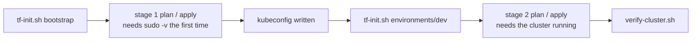

# 04 Terraform operations

| | |
|---|---|
| **Scope** | Both Terraform roots of `tp-local`: `bootstrap` (stage 1) and `environments/dev` (stage 2) |
| **Status** | Init/validate **Validated** offline; stage 1 plan validated (9 steps); plans/applies against a real cluster **Pending external prerequisites** |
| **Code** | `scripts/tf-init.sh`, `bootstrap/*.tf`, `environments/dev/*.tf`, `modules/microk8s/main.tf`, `modules/k8s-namespace/main.tf` |

**Context:** WSL, as the cluster owner. Paths are relative to the repository
root (e.g. `~/src/generic-infra`).

## 1. What Terraform manages, and how

| Object | Managed by | Terraform sees changes made outside? |
|---|---|---|
| MicroK8s snap, channel, add-ons, readiness, kubeconfig | Stage 1 `terraform_data` steps running scripts | **No**: `terraform_data` has no read; use `-replace` (TF-08) |
| Namespaces, quotas, limits, network policies, service accounts, role bindings, StorageClass, node labels | Stage 2 Kubernetes provider | Yes: drift appears in the plan |
| Helm releases | Stage 2 Helm provider | Yes (version, values, status) |
| WSL, systemd, snapd, Terraform itself | `prepare-wsl.sh` / operator | Not managed |

## 2. Execution order



Stage 2 cannot plan without a reachable cluster: its providers and the
`data.kubernetes_nodes.all` connectivity check read the kubeconfig at plan
time. Destroy in the opposite order (TF-10).

## TF-01 Initialize a root

**Status:** Validated for `bootstrap` (script run on a scratch copy of the
repository with a scratch `TP_LOCAL_STATE_DIR`, Git Bash on Windows); not yet
run inside WSL.

```bash
tp-local/scripts/tf-init.sh bootstrap
tp-local/scripts/tf-init.sh environments/dev
tp-local/scripts/tf-init.sh environments/dev -upgrade      # extra flags are passed to terraform init
```

**Expected result:** `tf-init: root=bootstrap state=<state-dir>/bootstrap.tfstate`
(or `environments-dev.tfstate`), then `Terraform has been successfully initialized!`.
`<state-dir>` is `$TP_LOCAL_STATE_DIR`, else `$XDG_STATE_HOME/tp-local`, else
`~/.local/state/tp-local` (created with mode 700). The state file itself
appears at the first apply.

> [!WARNING]
> Always initialize through `tf-init.sh`. A plain `terraform init` uses
> `./terraform.tfstate` in the root directory: a **second, empty state** that
> would try to recreate everything.

`TP_LOCAL_STATE_DIR=<dir>` overrides the state directory (same value for every
run on the machine). After changing it, re-run `tf-init.sh … -migrate-state`
to move the existing state.

## TF-02 Format and validate (offline)

**Status:** Validated.

```bash
terraform -chdir=tp-local fmt -check -recursive
for d in bootstrap modules/microk8s modules/k8s-namespace environments/dev; do
  (cd "tp-local/$d" && terraform init -backend=false -input=false >/dev/null && terraform validate)
done
ci/scripts/run-local.sh tp-local        # same gates as the pipeline
```

Expected: no file listed by `fmt`; `Success! The configuration is valid.` for
the 4 configurations. `init -backend=false` does not touch the real state.

## TF-03 Plan stage 1

**Status:** Implemented (first plan validated offline). **Context:** `tp-local/bootstrap`.

```bash
terraform plan -out=bootstrap.tfplan
```

Planning never executes scripts and needs no sudo.

| Situation | Expected plan |
|---|---|
| First run | 9 to add (install, channel, 5 add-ons, ready, kubeconfig) |
| Nothing changed | `No changes.` |
| `microk8s_channel` changed | Replace `terraform_data.channel`, `.ready`, `.kubeconfig` (in-place `snap refresh`; cluster data kept); update in place of every `addon[*]` (stored channel only, nothing re-run) |
| Add-on added / removed | Add / destroy `terraform_data.addon["<name>"]`, replace `.ready` |
| Add-on `args` changed | Replace `terraform_data.addon["<name>"]` (disable + enable), replace `.ready` |
| `kubeconfig_path` or `api_server_address` changed | Replace `terraform_data.kubeconfig` (old file removed, new one written) |
| `uninstall_on_destroy` changed | Update in place of `terraform_data.install` (stored flag only) |

## TF-04 Apply stage 1

**Status:** Pending external prerequisites.

```bash
sudo -v                                  # needed when installing or changing the channel
terraform apply bootstrap.tfplan
terraform output
```

Script output lines start with `[tp-local/microk8s]`. A failing command is
reported as `ERROR: command failed (exit <code>): <command>`. Steps already
completed stay in state; fix the cause and re-run plan/apply (all scripts are
idempotent).

## TF-05 Plan and apply stage 2

**Status:** Pending external prerequisites (configuration validated offline).
**Context:** `tp-local/environments/dev`.

```bash
microk8s status --wait-ready --timeout 120      # the cluster must be up
terraform plan -out=dev.tfplan
terraform apply dev.tfplan
```

First plan: **14 to add**: per namespace `kubernetes_namespace_v1`,
`kubernetes_default_service_account_v1` (+ for `apps`: resource quota, limit
range, 3 network policies, service account `app-deployer` and its role
binding), the `microk8s-hostpath-retain` StorageClass, one node label set,
and `helm_release.this["podinfo"]`.

Review rules: deletions of `kubernetes_namespace_v1` delete **everything** in
the namespace; Helm release replacements reinstall the application.

## TF-06 Read outputs

**Status:** Pending external prerequisites.

```bash
terraform -chdir=tp-local/bootstrap output                              # channel, add-ons, kubeconfig, API URL, next steps
terraform -chdir=tp-local/bootstrap output -raw kubeconfig_path
terraform -chdir=tp-local/environments/dev output nodes                 # Ready, kubelet version, OS image per node
terraform -chdir=tp-local/environments/dev output namespaces            # PSA level, isolation, service accounts
terraform -chdir=tp-local/environments/dev output helm_releases         # namespace, chart-version, status
terraform -chdir=tp-local/environments/dev output storage_classes
```

## TF-07 Inspect state

**Status:** Pending external prerequisites.

```bash
terraform -chdir=tp-local/bootstrap state list
terraform -chdir=tp-local/environments/dev state list
terraform -chdir=tp-local/environments/dev state show 'helm_release.this["podinfo"]'
ls -l ~/.local/state/tp-local/        # *.tfstate and *.tfstate.backup (previous version)
```

The stage 1 state only holds step inputs (paths, flags); the stage 2 state
holds Kubernetes object specifications and Helm values. Neither contains the
kubeconfig. Backups and recovery: [07 R-03](07-troubleshooting-and-recovery.md#r-03-restore-a-terraform-state-from-its-backup),
[08 MNT-07](08-maintenance-and-lifecycle.md#mnt-07-back-up-the-environment).

## TF-08 Re-run a provisioning step

**Status:** Implemented.

Stage 1 steps run again only when their triggers change. After a manual
change on the host, force the relevant step:

| Situation | Command (in `tp-local/bootstrap`) |
|---|---|
| Kubeconfig deleted or certificates refreshed | `terraform apply -replace='module.microk8s.terraform_data.kubeconfig'` |
| Add-on disabled by hand | `terraform apply -replace='module.microk8s.terraform_data.addon["<name>"]'` |
| Readiness check after an incident | `terraform apply -replace='module.microk8s.terraform_data.ready'` |
| MicroK8s removed by hand, reinstall | `sudo -v && terraform apply -replace='module.microk8s.terraform_data.install'` |

> [!CAUTION]
> Replacing `terraform_data.install` runs its destroy step first: with
> `uninstall_on_destroy = true` that **removes MicroK8s and all its data**.
> Keep the default `false` before using this `-replace`. It also replaces
> every `addon[*]`, `ready` and `kubeconfig` (they trigger on the install
> ID): add-ons are disabled (skipped when MicroK8s is absent) and re-enabled,
> and the kubeconfig is rewritten.

## TF-09 Change MicroK8s settings

**Status:** Implemented. Edit stage 1 variables (in a tfvars file passed with
`-var-file`, or the defaults of `bootstrap/variables.tf`), then TF-03/TF-04:

| Variable | Default | Runbook |
|---|---|---|
| `microk8s_channel` | `1.35/stable` | [08 MNT-01](08-maintenance-and-lifecycle.md#mnt-01-upgrade-microk8s-kubernetes-minor-version) |
| `addons` | dns, rbac, hostpath-storage, metrics-server, ingress | [03 MK-08](03-microk8s-operations.md#mk-08-manage-add-ons) |
| `kubeconfig_path` | `~/.kube/tp-local-microk8s.yaml` | Keep `environments/dev` `kubeconfig_path` identical |
| `api_server_address` | `127.0.0.1` | — |
| `wait_timeout_seconds` | `600` | Raise on slow machines |
| `uninstall_on_destroy` | `false` | TF-10 |

## TF-10 Destroy

**Status:** Pending external prerequisites.

> [!CAUTION]
> Stage 2 destroy deletes the namespaces `apps` and `sandbox` with
> everything inside, and uninstalls the Helm releases. Volumes using
> `microk8s-hostpath-retain` keep their data on disk.

```bash
cd tp-local/environments/dev
terraform plan -destroy -out=destroy.tfplan && terraform apply destroy.tfplan

cd ../../bootstrap
terraform plan -destroy -out=destroy.tfplan && terraform apply destroy.tfplan
```

Stage 1 destroy disables the managed add-ons (data kept), removes the
kubeconfig and **keeps MicroK8s installed**. To remove MicroK8s too, record
the choice in state first (destroy-time steps read the stored flag):

```bash
sudo -v
terraform apply -var 'uninstall_on_destroy=true'
terraform destroy -var 'uninstall_on_destroy=true'
```

**Validation:** `snap list microk8s` fails after a full removal;
`terraform state list` is empty in both roots.

## References

* [01 Architecture §3](01-architecture.md#3-stage-1-the-microk8s-module), [03 MicroK8s operations](03-microk8s-operations.md)
* Module READMEs: `modules/microk8s/README.md`, `modules/k8s-namespace/README.md`
