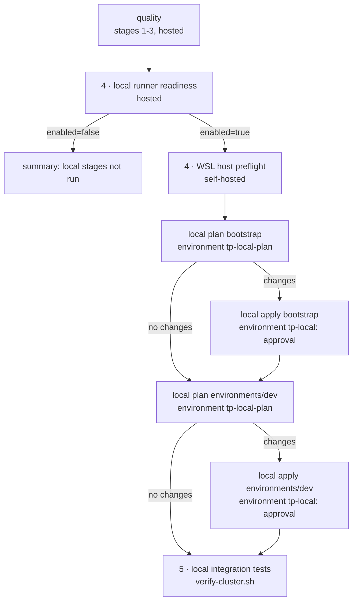

# 06 CI/CD and local deployment

| | |
|---|---|
| **Scope** | Running `tp-local` through GitHub Actions: hosted quality gates, the self-hosted WSL runner, approvals, and how pipeline runs coexist with interactive runs |
| **Status** | Workflows **Implemented** (policy tests and local gates validated); not yet executed on GitHub Actions; self-hosted runner **Pending external prerequisites** (none registered) |
| **Code** | `.github/workflows/tp-local.yml`, `.github/workflows/_terraform-quality.yml`, `.github/workflows/_terraform-plan.yml`, `.github/workflows/_terraform-apply.yml`, `ci/scripts/` |

The pipeline design, gates, security rules and GitHub configuration are
described once in the [CI/CD documentation](../../../docs/ci-cd.md); this
runbook covers the operator procedures.

## 1. Where each part runs

| Part | Runner | Runs when |
|---|---|---|
| Stages 1-3: fmt, validate/test, minimum version, script tests, lint, security | GitHub-hosted `ubuntu-24.04` | Every pull request / push to `main` touching `tp-local/**` or shared CI files |
| Readiness decision | GitHub-hosted | Always, after the gates; writes why local stages did or did not run |
| Preflight, plans, applies, integration tests | **Self-hosted in WSL**, labels `[self-hosted, linux, wsl, microk8s]` | Only `workflow_dispatch` from `main` with `local-deploy: true` **and** repository variable `TP_LOCAL_RUNNER_ENABLED=true` |

A hosted runner never targets the cluster: it cannot reach a laptop, and
the state lives in the WSL distribution. Details:
[CI/CD §9](../../../docs/ci-cd.md#9-tp-local-pipeline-and-the-self-hosted-wsl-runner).



## CD-01 Run the gates locally before pushing

**Status:** Validated (Terraform gates and script suites through
`run-local.sh`). **Context:** WSL or any Linux x86_64 shell, repository root.

```bash
ci/scripts/run-local.sh tp-local
```

Expected: every Terraform gate and script test passes. Installing the
scanners (TFLint, ShellCheck, Trivy, Checkov…) for a complete local run:
[CI/CD §11 Running the gates locally](../../../docs/ci-cd.md#running-the-gates-locally).

## CD-02 Validate a change through a pull request

**Status:** Implemented (not yet executed on GitHub Actions).
**Context:** any shell with Git; GitHub web UI or `gh`.

1. Push a branch and open a pull request.
2. Hosted jobs run stages 1-3; the `quality gate` job must pass.
3. `4 · local runner readiness` ends with the notice
   `local stages only run on a manual dispatch`: expected on a pull request.

```bash
gh pr checks <pr-number>
```

**Troubleshooting:** gate failures:
[CI/CD §12](../../../docs/ci-cd.md#12-troubleshooting).

## CD-03 Register the self-hosted WSL runner

**Status:** Pending external prerequisites.

**Prerequisites:**

* Private repository (a public repository would let pull requests run
  code on your machine).
* WSL setup done and the cluster bootstrapped **interactively** once
  ([02 SET-01..11](02-wsl-initial-setup.md)).
* The runner runs as the **cluster owner** (same Linux user): it must share
  `~/.local/state/tp-local` and `~/.kube/tp-local-microk8s.yaml`, and be a
  member of the `microk8s` group.

**Procedure:** follow
[CI/CD §9 Setting up the self-hosted runner](../../../docs/ci-cd.md#setting-up-the-self-hosted-runner-wsl-ubuntu)
(download from the GitHub page with its SHA-256, `config.sh` with labels
`wsl,microk8s`, systemd service as `$USER`).

**Validation (WSL):**

```bash
cd ~/actions-runner && sudo ./svc.sh status     # active (running)
id -nG | tr ' ' '\n' | grep -x microk8s         # runner user is in the group
ls ~/.local/state/tp-local/                      # the state the pipeline will use
```

GitHub → *Settings → Actions → Runners*: the runner is *Idle* with the
labels `self-hosted`, `Linux`, `X64`, `wsl`, `microk8s`.

**Rollback:** CD-10.

## CD-04 Configure the GitHub environments and variable

**Status:** Pending external prerequisites. **Context:** GitHub web UI
(*Settings → Environments*, *Settings → Secrets and variables → Actions*) or `gh`.

| Item | Setting |
|---|---|
| Environment `tp-local-plan` | No reviewer (plans only) |
| Environment `tp-local` | Required reviewer: the cluster owner; deployment branches: `main` only |
| Repository variable `TP_LOCAL_RUNNER_ENABLED` | `true`, only once CD-03 is done |

```bash
gh variable set TP_LOCAL_RUNNER_ENABLED --body true
gh variable list
```

No secret is needed: the state and kubeconfig stay on the WSL machine.
Reference: [CI/CD §10](../../../docs/ci-cd.md#10-required-configuration-github).

## CD-05 Run a local deployment

**Status:** Pending external prerequisites.
**Prerequisites:** CD-03, CD-04; WSL running (the runner starts with the
distribution's systemd); changes merged to `main`.

GitHub → *Actions → tp-local → Run workflow*, branch `main`, check
`local-deploy`; or:

```bash
gh workflow run tp-local.yml --ref main -f local-deploy=true
gh run list --workflow tp-local.yml --limit 1     # get the run ID
gh run watch <run-id>
```

**Expected result:** jobs in the order of §1. A stage without changes skips
its apply job; integration tests run in every case and end with
`verify-cluster: all checks passed`.

**Validation:** the run summary shows each plan's change counts; the
integration job is green.

## CD-06 Review and approve a plan

**Status:** Pending external prerequisites.

1. Open the run summary: change counts and every destructive change.
2. If needed, download the reviewed plan:

   ```bash
   gh run download <run-id> -n tfplan-tp-local-environments-dev-local -D ./plan-review
   less ./plan-review/tfplan.txt
   ```

   The stage 1 artifact is `tfplan-tp-local-bootstrap-local`.
3. On the run page: *Review deployments* → `tp-local` → *Approve and deploy*
   (or *Reject*: the apply is skipped, nothing changes).

> [!WARNING]
> Plan files can contain sensitive values in clear text. Delete the local
> copy after review (`rm -rf ./plan-review`); artifacts expire after 5 days.

The apply job applies **that** saved plan; a plan made for another commit,
or made stale by a later state change, is refused. Rules:
[CI/CD §6](../../../docs/ci-cd.md#6-deployment-authorization).

## CD-07 Authorize deletions or replacements

**Status:** Pending external prerequisites.

The apply guard refuses a plan that deletes or replaces resources. After
checking the list in the run summary (namespace deletions remove their
whole content, see [05 K8S-01](05-kubernetes-and-helm.md#k8s-01-add-change-or-remove-a-namespace)):

```bash
gh workflow run tp-local.yml --ref main -f local-deploy=true -f allow-destroy=true
```

The approval (CD-06) is still required.

## CD-08 Changes that need root

**Status:** Implemented (by design).

The runner user has no passwordless sudo. Stage 1 steps that need root
fail in CI with
`root privileges are required to … Run 'sudo -v' (credentials are cached ~15 min) and re-run 'terraform apply'.`:

| Change | Root needed for |
|---|---|
| First installation | `snap install microk8s`, adding the user to `microk8s` |
| `microk8s_channel` change | `snap refresh` |
| Uninstall (`uninstall_on_destroy = true`) | `snap remove --purge` |

**Procedure:** apply that change interactively in WSL from an up-to-date
checkout of `main` ([04 TF-04](04-terraform-operations.md#tf-04-apply-stage-1)),
then run CD-05: the bootstrap plan shows `No changes.` and its apply is
skipped.

## CD-09 Interactive and pipeline runs on the same machine

**Status:** Implemented.

Both use the same state files and kubeconfig (same Linux user and
`$HOME`). Module paths in the state are relative, so the runner's checkout
directory does not create differences.

| Rule | Why |
|---|---|
| Apply only code that is on `main` (pipeline or interactive) | An interactive apply of an unmerged branch is reverted by the next pipeline apply |
| Do not run an interactive apply while a pipeline run is active | Terraform locks the local state file; the second run fails with `Error acquiring the state lock` |
| Do not set a different `TP_LOCAL_STATE_DIR` for one of them | Two states would manage the same cluster |
| Use the pipeline for routine changes, interactive runs for root-only changes (CD-08) and incidents | Keeps the reviewed plan as the normal path |

## CD-10 Pause or remove the self-hosted runner

**Status:** Pending external prerequisites.

Pause local deployments (gates keep running):

```bash
gh variable set TP_LOCAL_RUNNER_ENABLED --body false
```

Stop or remove the runner (WSL):

```bash
cd ~/actions-runner
sudo ./svc.sh stop
sudo ./svc.sh uninstall
./config.sh remove --token <removal-token>     # token from Settings → Actions → Runners → the runner
```

The cluster, state and kubeconfig are not affected.

## Troubleshooting

Pipeline symptoms (skipped local stages, queued jobs, refused applies,
`sudo -v` on the runner):
[CI/CD §12](../../../docs/ci-cd.md#12-troubleshooting). Cluster symptoms
reported by the preflight, plan or integration jobs: 07 Troubleshooting and
recovery.

## References

* [CI/CD documentation](../../../docs/ci-cd.md), [04 Terraform operations](04-terraform-operations.md)
* Workflow: `.github/workflows/tp-local.yml`
