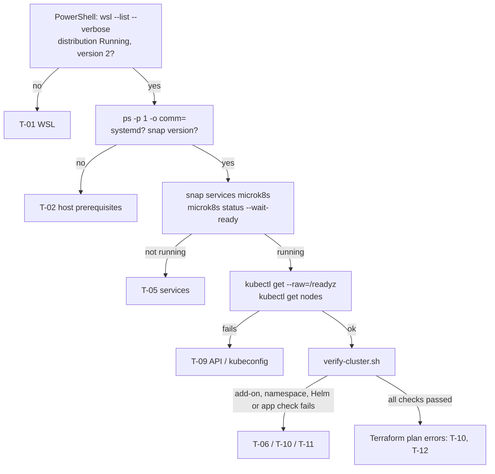

# 07 Troubleshooting and recovery

| | |
|---|---|
| **Scope** | Diagnosing failures of the WSL host, MicroK8s, Terraform, Helm and the pipeline; recovering access, state and the cluster |
| **Status** | Error messages quoted from the project scripts are **Implemented** (and covered by the stubbed script suite); diagnosis and recovery steps are **Pending external prerequisites** (never exercised on a real cluster) |
| **Code** | `modules/microk8s/scripts/*.sh`, `scripts/verify-cluster.sh`, `scripts/tf-init.sh` |

**Context:** WSL as the cluster owner unless marked **PowerShell** or
**(sudo)**. Messages in `code` are printed by the project scripts (prefix
`[tp-local/microk8s]` or `[FAIL]`); other messages come from Terraform,
Kubernetes or Helm and may vary slightly between versions.

## 1. Diagnose layer by layer

Work from the bottom up: a failure in a lower layer explains every symptom
above it.



## T-00 Collect diagnostics

**Status:** Pending external prerequisites.

```powershell
wsl --list --verbose                       # PowerShell: distribution state and version
```

```bash
ps -p 1 -o comm=; snap version | head -2
snap services microk8s
microk8s status --wait-ready --timeout 30
kubectl get --raw=/readyz; kubectl get nodes -o wide
kubectl get pods -A --field-selector=status.phase!=Running,status.phase!=Succeeded
kubectl get events -A --sort-by=.lastTimestamp | tail -30
tp-local/scripts/verify-cluster.sh
sudo microk8s inspect                      # (sudo) full report; attach its archive to an escalation
```

> [!WARNING]
> The `microk8s inspect` archive contains cluster configuration and logs.
> Review it before sharing it outside the team.

## T-01 WSL and the distribution

**Status:** Pending external prerequisites. **Context:** PowerShell.

| Symptom | Cause | Fix |
|---|---|---|
| `Test-WslHost.ps1` prints `[FAIL]` | WSL or the distribution missing, or version 1 | [02 SET-02](02-wsl-initial-setup.md#set-02-install-wsl-and-the-ubuntu-distribution); `wsl --set-version Ubuntu-24.04 2` |
| Distribution `Stopped`, cluster unreachable | WSL shut down (idle timeout, reboot, `wsl --shutdown`) | `wsl -d Ubuntu-24.04` (MicroK8s starts with systemd), then R-01 |
| WSL slow or killed under load, pods `OOMKilled` / `Evicted` | Memory limit of `.wslconfig` too low | [02 SET-03](02-wsl-initial-setup.md#set-03-configure-wsl-resources): raise `memory=`, `wsl --shutdown` |
| WSL fails to start after a Windows update | Outdated WSL package | `wsl --update`, then `wsl --shutdown` |

## T-02 Host prerequisites

**Status:** Implemented (messages); fixes Pending external prerequisites.

| Message (preflight, every stage 1 apply) | Fix |
|---|---|
| `MicroK8s requires Linux: run Terraform from WSL Ubuntu, not from Windows.` | Run Terraform inside WSL, not from PowerShell or Git Bash |
| `systemd is not PID 1 (found '…')` | `sudo tp-local/scripts/wsl/prepare-wsl.sh`, then PowerShell `wsl --shutdown` ([02 SET-05](02-wsl-initial-setup.md#set-05-prepare-ubuntu-prepare-wslsh)) |
| `snapd is not installed: run 'sudo tp-local/scripts/wsl/prepare-wsl.sh' …` | As stated |
| Warning `… MiB of RAM visible (recommended >= 4096 MiB)` | Raise WSL memory (T-01) |
| Warning `… GiB free under /var (recommended >= 20 GiB …)` | Free space (old snap revisions: `snap list --all microk8s`; unused images: `sudo microk8s ctr images ls`), or enlarge the WSL disk |
| `prepare-wsl.sh`: `run with sudo: …` / `Ubuntu is required (found …).` | Run it with `sudo` inside the Ubuntu distribution |
| `prepare-wsl.sh`: `terraform … not found in the HashiCorp repository.` | Version in `tp-local/.terraform-version` not published for this Ubuntu release, or network/proxy problem: `apt-cache madison terraform` |

## T-03 MicroK8s installation and channel changes

**Status:** Implemented (messages); fixes Pending external prerequisites.

| Symptom | Cause | Fix |
|---|---|---|
| `root privileges are required to … Run 'sudo -v' …` | sudo credentials not cached or expired (they last about 15 min) | `sudo -v`, re-run plan/apply (completed steps are kept; scripts are idempotent) |
| `snap install` fails or hangs | Network, proxy or Snap Store problem | `snap changes`, `snap tasks <change-id>`; check `curl -sI https://api.snapcraft.io`; retry |
| `cannot move between classic and strict confinement (…) with snap refresh: reinstall instead …` | `microk8s_channel` changed between a classic and a `-strict` track | Revert the channel, or reinstall: R-06 |
| `MicroK8s is not installed (install.sh must run first).` | MicroK8s removed by hand while the state still records the install | [04 TF-08](04-terraform-operations.md#tf-08-re-run-a-provisioning-step) (replace `install`) |
| `could not acquire … after 900s. If no Terraform run is active, remove it: rmdir '…'.` | Lock left by an interrupted run (or a concurrent run) | Make sure no Terraform run is active (`pgrep -a terraform`), then the printed `rmdir` |

## T-04 Permissions

**Status:** Pending external prerequisites.

| Symptom | Cause | Fix |
|---|---|---|
| `microk8s` commands fail with *Insufficient permissions to access MicroK8s* | Current shell predates the `microk8s` group membership | `newgrp microk8s` or reopen the terminal ([02 SET-08](02-wsl-initial-setup.md#set-08-activate-the-microk8s-group-membership)) |
| `[FAIL] kubeconfig mode is …, expected 600` | File permissions changed | `chmod 600 ~/.kube/tp-local-microk8s.yaml` |
| `kubectl` *Forbidden* for a service account | Missing or wrong binding | [05 K8S-03](05-kubernetes-and-helm.md#k8s-03-manage-rbac) (`kubectl auth can-i … --as=…`) |
| Pod rejected: *violates PodSecurity "baseline:latest"* | Pod spec not allowed by the namespace's Pod Security level | Fix the `securityContext`, or deploy to `sandbox`; levels: [05 §1](05-kubernetes-and-helm.md#1-what-a-managed-namespace-contains) |
| Self-hosted runner: `root privileges are required …` | Expected for root-only changes | [06 CD-08](06-cicd-and-deployment.md#cd-08-changes-that-need-root) |

## T-05 MicroK8s services and readiness

**Status:** Implemented (messages); fixes Pending external prerequisites.

| Symptom | Cause | Fix |
|---|---|---|
| `MicroK8s did not become ready within …s (see 'microk8s inspect').` | Services slow to start (first start, image pulls) or failing | `snap services microk8s`; `journalctl -u snap.microk8s.daemon-kubelite --since "15 min ago"`; slow machine: raise `wait_timeout_seconds` ([04 TF-09](04-terraform-operations.md#tf-09-change-microk8s-settings)) |
| `the Kubernetes node did not become Ready within …s.` | kubelet or CNI not healthy | `kubectl describe node`; `kubectl -n kube-system get pods`; R-01 |
| `microk8s status` says *not running* | Services stopped | `microk8s start` ([03 MK-06](03-microk8s-operations.md#mk-06-stop-and-start-the-cluster)) |
| Services restart in a loop | Datastore or disk problem | `journalctl -u snap.microk8s.daemon-k8s-dqlite`; `df -h /var`; `sudo microk8s inspect` |
| Cluster restarted on its own | Automatic snap refresh within the channel | [08 MNT-02](08-maintenance-and-lifecycle.md#mnt-02-control-automatic-snap-refreshes) |

## T-06 Add-ons

**Status:** Implemented (messages); fixes Pending external prerequisites.

| Symptom | Cause | Fix |
|---|---|---|
| `some deployments are not Available: microk8s kubectl get deploy -A` | An add-on Deployment does not become Available (image pull, resources) | `kubectl get deploy -A`; `kubectl -n <namespace> describe pod <pod>` (events: `ErrImagePull`, `Insufficient cpu`) |
| `daemonset <namespace>/<name> is not ready` | Same, for a DaemonSet (CNI, ingress controller) | `kubectl -n <namespace> rollout status daemonset/<name>` |
| `[FAIL] add-on <name> not enabled` | Disabled by hand (Terraform does not detect it) | [04 TF-08](04-terraform-operations.md#tf-08-re-run-a-provisioning-step) (replace that `addon`) |
| Image pulls fail (`ErrImagePull`, `ImagePullBackOff`) | No internet, proxy, DNS in WSL | Test from WSL: `curl -sI https://registry.k8s.io`; T-07 |

## T-07 DNS

**Status:** Pending external prerequisites.

| Symptom | Cause | Fix |
|---|---|---|
| Pods cannot resolve service names | CoreDNS down or `dns` add-on disabled | [03 MK-09](03-microk8s-operations.md#mk-09-dns-coredns); re-enable through Terraform |
| Pods resolve services but not internet names | Upstream DNS unreachable from WSL (VPN, corporate DNS) | Check the host first: `getent hosts github.com`; then [02 SET-09](02-wsl-initial-setup.md#set-09-network-configuration) |
| `podinfo.localtest.me` does not resolve | Public wildcard DNS name blocked by the local resolver | Use `curl -H 'Host: podinfo.localtest.me' http://<wsl-ip>/` as in [05 K8S-10](05-kubernetes-and-helm.md#k8s-10-check-deployment-health) |

## T-08 Storage

**Status:** Pending external prerequisites.

| Symptom | Cause | Fix |
|---|---|---|
| PVC stays `Pending` | `hostpath-storage` add-on not ready, wrong `storageClassName`, or quota reached | `kubectl describe pvc <pvc> -n <namespace>`; `kubectl get storageclass`; `kubectl -n apps describe resourcequota apps-quota` (10 PVCs in `apps`) |
| Volume data disappeared after deleting a claim | `microk8s-hostpath` has the Delete policy | Use `microk8s-hostpath-retain` for data to keep ([03 MK-10](03-microk8s-operations.md#mk-10-storage-hostpath)) |
| Disk full in WSL | Images, volumes, logs | `df -h /var`; `sudo du -sh /var/snap/microk8s/common/*` (sudo) |

## T-09 API server and kubeconfig

**Status:** Implemented (messages); fixes Pending external prerequisites.

| Symptom | Cause | Fix |
|---|---|---|
| `[FAIL] kubeconfig … not found (apply tp-local/bootstrap first)` | Stage 1 not applied, or file deleted | R-02 |
| `[FAIL] API server not reachable`; `connection refused` on `127.0.0.1:16443` | MicroK8s stopped, or WSL not running | T-05, T-01 |
| `x509: certificate signed by unknown authority` / certificate expired | Certificates regenerated or refreshed since the export | R-02 |
| Export warning `https://…/readyz did not answer …` | API not yet answering, or wrong `api_server_address` | Wait and re-export (R-02); keep `127.0.0.1` unless needed |
| `unexpected 'microk8s config' output: no API server URL on port …` | `microk8s config` failed or changed format | Run `microk8s config` by hand; report the output |
| Windows `kubectl` cannot connect | Windows copy outdated, or localhost forwarding disabled | Copy the kubeconfig again ([02 SET-10](02-wsl-initial-setup.md#set-10-configure-kubernetes-access)) |

## T-10 Terraform and providers

**Status:** Pending external prerequisites.

| Symptom | Cause | Fix |
|---|---|---|
| Stage 2 plan: `connection refused` / *Kubernetes cluster unreachable* | Cluster down: providers and `data.kubernetes_nodes.all` read it at plan time | T-05, then plan again |
| A plan wants to **create everything** | `terraform init` run without `tf-init.sh`: a new, empty state in the root directory | Delete the stray `terraform.tfstate` in the root, re-run [04 TF-01](04-terraform-operations.md#tf-01-initialize-a-root) |
| `Error acquiring the state lock` | Another run (interactive or pipeline) is active | Wait. Use `terraform force-unlock <lock-id>` only if no run is active |
| `Inconsistent dependency lock file` / provider checksum mismatch | Provider constraint changed without updating the lock file | [CI/CD §12](../../../docs/ci-cd.md#12-troubleshooting) (lock for the four platforms) |
| Variable validation error (`helm_releases versions must be exact chart versions …`, reserved namespace…) | Input refused by design | Fix the tfvars value ([05](05-kubernetes-and-helm.md)) |

## T-11 Helm releases and workloads

**Status:** Pending external prerequisites.

| Symptom | Cause | Fix |
|---|---|---|
| Apply fails: *release … failed, and has been rolled back due to atomic being set* (or *uninstalled* on a first install) | Pods not healthy before `timeout_seconds` | `kubectl -n <namespace> get events --sort-by=.lastTimestamp`; fix values (resources, image, `securityContext`) and apply again |
| *another operation (install/upgrade/rollback) is in progress* | An interrupted Helm operation left a pending release | `helm history <release> -n <namespace>`; `helm rollback <release> <last-deployed-revision> -n <namespace>`, then apply |
| ReplicaSet events: `exceeded quota` | `apps` ResourceQuota reached | `kubectl -n apps describe resourcequota apps-quota`; lower requests or raise the quota ([05 K8S-02](05-kubernetes-and-helm.md#k8s-02-adjust-quotas-limits-and-isolation)) |
| `[FAIL] Helm releases not deployed: …` | A release is `failed` or `pending-*` | Same as above, then `terraform apply` |
| `[FAIL] http://podinfo.localtest.me did not answer through the ingress …` | Ingress controller, Service or network policy | [03 MK-11](03-microk8s-operations.md#mk-11-ingress); `kubectl -n apps get networkpolicy` (the `ingress` namespace must be allowed) |

## T-12 State inconsistencies

**Status:** Pending external prerequisites.

| Symptom | Cause | Fix |
|---|---|---|
| Plan recreates an object that was deleted by hand | Normal drift correction (stage 2) | Apply, or remove it from code if the deletion was intended |
| Apply fails: `namespaces "<name>" already exists` (or another *already exists*) | Object created outside Terraform, or state lost | Import it (R-04) |
| Stage 1 says `No changes.` but the host differs (add-on disabled, kubeconfig deleted) | `terraform_data` steps do not read the host | [04 TF-08](04-terraform-operations.md#tf-08-re-run-a-provisioning-step) |
| State file deleted or corrupted | Disk issue, manual deletion | R-03, else R-04 / R-05 |

## T-13 Pipeline

**Status:** see [06](06-cicd-and-deployment.md). Pipeline-level symptoms (local stages
skipped, runner offline, refused applies):
[CI/CD §12](../../../docs/ci-cd.md#12-troubleshooting). Failures inside the
preflight, plan or integration jobs: the sections above, using the job log.

## R-01 Restart the cluster

**Status:** Pending external prerequisites. Escalate one level at a time:

```bash
sudo snap restart microk8s.daemon-kubelite        # (sudo) 1. control plane + kubelet
sudo snap restart microk8s                        # (sudo) 2. every MicroK8s service
microk8s stop && microk8s start                   #       3. full stop/start
microk8s status --wait-ready --timeout 300
```

```powershell
wsl --shutdown                                    # 4. PowerShell: restart the whole WSL VM
wsl -d Ubuntu-24.04
```

**Validation:** `tp-local/scripts/verify-cluster.sh`. Workloads restart on
their own; no data is lost.

## R-02 Regain cluster access

**Status:** Pending external prerequisites.

1. Without the kubeconfig: `microk8s kubectl get nodes` (needs the
   `microk8s` group, or `sudo`).
2. Re-export the kubeconfig through Terraform:

   ```bash
   cd tp-local/bootstrap
   terraform apply -replace='module.microk8s.terraform_data.kubeconfig'
   ```

3. Check: `kubectl get --raw=/readyz` → `ok`; copy it again to Windows if used.

## R-03 Restore a Terraform state from its backup

**Status:** Pending external prerequisites.

Terraform keeps the previous version of each state next to it
(`<state>.tfstate.backup`, one version only). For older versions use your
own backups ([08 MNT-07](08-maintenance-and-lifecycle.md#mnt-07-back-up-the-environment)).

> [!CAUTION]
> Make sure no Terraform run (interactive or pipeline) is active. Keep the
> damaged file: never overwrite a state without a copy.

```bash
cd ~/.local/state/tp-local
cp environments-dev.tfstate "environments-dev.tfstate.damaged-$(date +%Y%m%d%H%M%S)"
cp environments-dev.tfstate.backup environments-dev.tfstate
cd ~/src/azure-infra/tp-local/environments/dev && terraform plan
```

**Validation:** the plan shows only the changes made after that backup.
Same procedure for `bootstrap.tfstate`.

## R-04 Rebuild a lost stage 2 state (import)

**Status:** Pending external prerequisites (import IDs follow the
Kubernetes and Helm provider conventions; not executed).

Keeps the existing objects and their data. In `tp-local/environments/dev`,
after `tf-init.sh environments/dev`:

```bash
terraform import 'module.namespaces["apps"].kubernetes_namespace_v1.this' apps
terraform import 'module.namespaces["apps"].kubernetes_default_service_account_v1.this' apps/default
terraform import 'module.namespaces["apps"].kubernetes_resource_quota_v1.this[0]' apps/apps-quota
terraform import 'module.namespaces["apps"].kubernetes_limit_range_v1.this[0]' apps/apps-limits
terraform import 'module.namespaces["apps"].kubernetes_network_policy_v1.default_deny_ingress[0]' apps/default-deny-ingress
terraform import 'module.namespaces["apps"].kubernetes_network_policy_v1.allow_same_namespace[0]' apps/allow-same-namespace
terraform import 'module.namespaces["apps"].kubernetes_network_policy_v1.allow_from_namespaces[0]' apps/allow-from-namespaces
terraform import 'module.namespaces["apps"].kubernetes_service_account_v1.this["app-deployer"]' apps/app-deployer
terraform import 'module.namespaces["apps"].kubernetes_role_binding_v1.service_account["app-deployer"]' apps/app-deployer-edit
terraform import 'module.namespaces["sandbox"].kubernetes_namespace_v1.this' sandbox
terraform import 'module.namespaces["sandbox"].kubernetes_default_service_account_v1.this' sandbox/default
terraform import 'kubernetes_storage_class_v1.hostpath_retain[0]' microk8s-hostpath-retain
terraform import 'helm_release.this["podinfo"]' apps/podinfo
terraform plan
```

Node labels (`kubernetes_labels.nodes`) need no import: the apply sets them
again. **Validation:** the plan shows at most in-place updates and the node
label creation, no namespace creation.

**Alternative (data loss accepted):** delete the namespaces `apps` and
`sandbox` and the release, then apply: Terraform recreates the 14 objects.

## R-05 Rebuild a lost stage 1 state

**Status:** Implemented (script idempotence covered by the stubbed suite).

The scripts detect what already exists (`MicroK8s already installed`, same
channel: no refresh, add-on enable is idempotent), so a plain apply rebuilds
the 9 steps without changing the cluster and without root:

```bash
tp-local/scripts/tf-init.sh bootstrap
cd tp-local/bootstrap && terraform plan -out=bootstrap.tfplan && terraform apply bootstrap.tfplan
```

## R-06 Recreate the cluster (reinstall MicroK8s)

**Status:** Pending external prerequisites.

For a cluster that cannot be repaired, or a classic/strict confinement
change. Stage 2 objects are recreated afterwards from code.

> [!CAUTION]
> This **deletes every workload and all volume data** under
> `/var/snap/microk8s`, including `microk8s-hostpath-retain` volumes. Back
> up first ([08 MNT-07](08-maintenance-and-lifecycle.md#mnt-07-back-up-the-environment)).

```bash
cd tp-local/bootstrap
sudo -v
terraform apply -var 'uninstall_on_destroy=true'          # 1. store the flag (in-place update)
terraform apply -var 'uninstall_on_destroy=true' -replace='module.microk8s.terraform_data.install'   # 2. purge + reinstall
terraform apply                                           # 3. store the safe default again
cd ../environments/dev
terraform plan -out=dev.tfplan && terraform apply dev.tfplan   # 4. recreate namespaces, policies, releases
```

Step 2 disables the add-ons, removes the kubeconfig, purges MicroK8s, then
reinstalls it, re-enables the add-ons and re-exports the kubeconfig. If
sudo credentials expire during step 2, run `sudo -v` and repeat it.

**Validation:** `tp-local/scripts/verify-cluster.sh` → `all checks passed`.

## R-07 Destroy and rebuild the environment

**Status:** Pending external prerequisites.

1. Back up what must survive ([08 MNT-07](08-maintenance-and-lifecycle.md#mnt-07-back-up-the-environment)).
2. Destroy both stages with uninstall: [04 TF-10](04-terraform-operations.md#tf-10-destroy).
3. Rebuild: [02 SET-07](02-wsl-initial-setup.md#set-07-install-microk8s-with-terraform-stage-1)
   to SET-11.

To rebuild the WSL distribution itself:
[08 MNT-10](08-maintenance-and-lifecycle.md#mnt-10-recreate-the-workstation-environment).

## References

* [03 MicroK8s operations](03-microk8s-operations.md), [04 Terraform operations](04-terraform-operations.md), [05 Kubernetes and Helm](05-kubernetes-and-helm.md)
* [CI/CD §12](../../../docs/ci-cd.md#12-troubleshooting)
